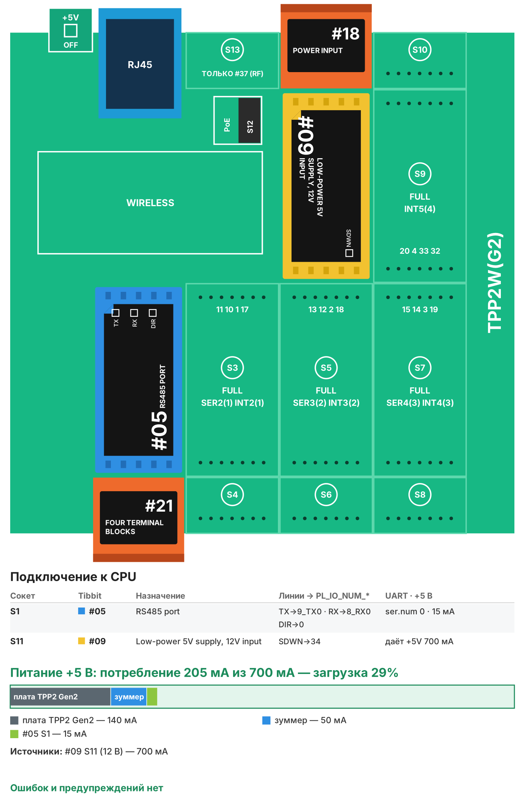

# Рецепт 01. Шлюз Modbus RTU → MQTT

Контроллер опрашивает приборы на линии RS-485 по Modbus RTU и публикует значения в MQTT-брокер. Счётчики, термостаты, частотники и другие приборы с Modbus появляются в SCADA, Wiren Board, Home Assistant, Node-RED или облаке без отдельного компьютера на объекте. Уставки можно менять обратно через MQTT.

| | |
|---|---|
| Плата | Tibbo TPP2(G2) в корпусе TPB2 |
| Интерфейсы | RS-485 (Modbus RTU, master), Ethernet (MQTT 3.1.1) |
| Питание | 12 В DC (Tibbit #09) |
| Прошивка | Tibbo BASIC, TIDE, библиотеки 2_01_05 |
| Проверка | Собирается в TIDE (библиотеки 2_01_05) без ошибок и предупреждений; вариант AppBlocks открывается в редакторе без ошибок и собирается. На устройстве не проверялось |
| Лицензия | MIT |

## Что в архиве

| Файл | Что это |
|---|---|
| `tide/` | Проект TIDE. Настройки - в `config.tbh` и `config.tbs` |
| `appblocks/recipe01_modbus_mqtt_appblocks.json` | Вариант для AppBlocks (кнопка Import на app.appblocks.io) |
| `bom.csv` | Спецификация со ссылками на каталог tibbo.ru |
| `board.svg`, `board.png` | Раскладка Tibbit по сокетам и бюджет питания |

## Комплект

| Кол-во | Позиция | Сокет |
|---|---|---|
| 1 | Плата TPP2(G2) | - |
| 1 | Корпус TPB2 | - |
| 1 | Tibbit #05 - порт RS-485 | S1 |
| 1 | Tibbit #21 - 4 клеммы (линия RS-485) | S2 |
| 1 | Tibbit #09 - источник питания 5 В от 9-18 В | S11 |
| 1 | Tibbit #18 - разъём питания и 2 клеммы | S12 |
| 1 | Блок питания 12 В DC, от 0,5 А (не входит в каталог Tibbo) | - |

Потребление по линии +5 В - около 205 мА при запасе источника 700 мА (загрузка 29%). Свободны четыре M-сокета: можно добавить входы, реле или ещё порты RS-485 (S3, S5, S7 - с последовательными портами).

**Почему TPP2(G2).** Это самая доступная плата, на которой решается задача: процессор и память те же, что у TPP3(G2), меньше только сокетов. TPP3(G2) с корпусом TPB3 стоит дороже и нужна, только если в шлюз добавляют больше модулей, чем помещается на TPP2.



**Питание - 12 В.** Tibbit #09 (вход 9-18 В) с разъёмом #18 - самый дешёвый вариант питания платы. В шкафу только 24 В - поставьте вместо #09 и #18 Tibbit #33 (вход 8-60 В) с клеммами #21: он дороже, но не требует отдельного блока 12 В. На 24 В Tibbit #09 подключать нельзя.

## Сборка

1. Вставьте Tibbit в сокеты по таблице. Ключ на корпусе Tibbit совпадает с ключом сокета.
2. Подключите линию RS-485 к клеммам #21 в сокете S2: A(+), B(-) и общий провод. Назначение клемм сверьте с [описанием Tibbit #05](https://docs.tibbo.com/tibbit_05). Если линия не работает, поменяйте местами A и B: производители приборов обозначают их по-разному.
3. На Tibbit #05 ревизии B (круглая наклейка «B») уже стоит терминатор 120 Ом. Если контроллер стоит не в конце линии, уточните схему по документации.
4. Подайте 12 В на разъём #18 в сокете S12 (на джек или на клеммы, не одновременно), подключите Ethernet.

## Настройка

Всё, что зависит от объекта, - в двух файлах:

- `config.tbh` - сеть (DHCP или статический адрес), адрес брокера, логин, корень топиков, скорость и чётность RS-485, период опроса.
- `config.tbs` - список точек опроса:

```basic
'point_add(адрес прибора, функция, регистр, тип, делитель, "имя", можно писать)
point_add(1, 4, 0, PT_F32, 1, "meter1/voltage", NO)
point_add(2, 3, 0, PT_S16, 10, "room/temperature", NO)
point_add(2, 3, 10, PT_U16, 10, "room/setpoint", YES)
```

- функция `3` - holding registers, `4` - input registers;
- регистр - номер с нуля (40001 в документации прибора → `0`);
- типы: `PT_U16`, `PT_S16` (один регистр), `PT_U32`, `PT_S32`, `PT_F32` (два регистра, старшее слово первым);
- делитель: 10 превращает 235 в 23.5;
- `YES` в последнем поле разрешает запись из MQTT (только `PT_U16`/`PT_S16`, функция 3).

## Топики MQTT

`<id>` - MAC-адрес контроллера в hex, например `002477517F17`.

| Топик | Направление | Что передаётся |
|---|---|---|
| `tibbo/<id>/<имя точки>` | контроллер → брокер | значение, например `23.5` |
| `tibbo/<id>/<имя точки>/set` | брокер → контроллер | новое значение для записи (функция 6) |
| `tibbo/<id>/status` | контроллер → брокер | `online ok=6 err=0` после каждого цикла опроса |

Проверить можно любым MQTT-клиентом:

```
mosquitto_sub -h 192.168.1.10 -t 'tibbo/#' -v
mosquitto_pub -h 192.168.1.10 -t 'tibbo/002477517F17/room/setpoint/set' -m 22.5
```

## Загрузка прошивки

1. Установите [TIDE](https://tibbo.ru/downloads) и откройте `tide/modbus_mqtt_gateway.tpr`.
2. Поправьте `config.tbh` и `config.tbs`, нажмите F7 (сборка).
3. Выберите контроллер в списке устройств (Device Explorer) и нажмите F5 - прошивка загрузится и запустится в режиме отладки. Для работы на объекте переключите сборку в Release и загрузите ещё раз.

## Индикация

| Светодиод | Что значит |
|---|---|
| Зелёный мигает | нет связи с брокером |
| Зелёный горит | брокер на связи |
| Красная вспышка | прибор не ответил или ответил с ошибкой |

В окне Output TIDE (debug-сборка) видны IP-адрес, подключение к брокеру и ошибки опроса.

## Частые проблемы

| Симптом | Что проверить |
|---|---|
| Все точки с ошибкой 255 | Перепутаны A и B; не совпадают скорость или чётность; неверный адрес прибора |
| Ошибка 254 | Помехи на линии: экранированная витая пара, терминатор на концах линии |
| Ошибка 2 или 3 | Прибор не знает такого регистра или функции - сверьте карту регистров |
| Зелёный мигает постоянно | Адрес брокера, порт 1883 открыт, логин и пароль; брокер в той же сети |
| Странные значения F32 | Прибор отдаёт младшее слово первым - выберите соседний регистр или попросите Claude добавить тип с обратным порядком |

## Вариант для AppBlocks

`appblocks/recipe01_modbus_mqtt_appblocks.json` - официальный пример Tibbo ModbusMQTTGateway, переведённый на TiOS и плату TPP2(G2) с тем же комплектом Tibbit. В нём приборы и регистры задаются в веб-консоли устройства, значения пишутся в таблицу и уходят в MQTT по таймеру. Откройте app.appblocks.io → Import → выберите файл, проверьте вкладку Problems и нажмите Run.

## Доработка с Claude

С [скиллами Tibbo для Claude](https://tibbo.ru/skills.html) проект можно менять словами:

- «Добавь в рецепт 01 второй порт RS-485 на Tibbit #05 в сокете S5 и опрашивай на нём приборы с адресами 10-20».
- «Публикуй все значения одним JSON-сообщением раз в минуту».
- «Добавь подключение к брокеру по TLS» (нужна плата TPP2(G3)).

Скилл подберёт Tibbit, проверит питание и напишет код под эту структуру проекта.

---
Рецепт подготовил Сканкод, официальный дистрибьютор Tibbo Technology в России и СНГ. Вопросы: iot@scancode.ru, https://tibbo.ru/contacts
