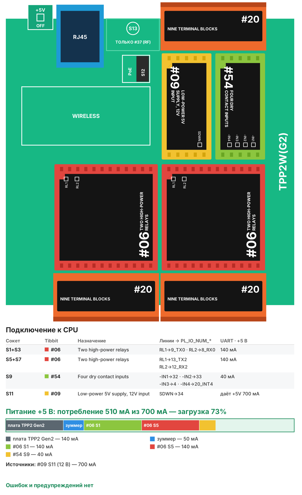

# Рецепт 02. Управление освещением: реле, веб-страница, расписание

Контроллер включает и выключает четыре линии освещения: по расписанию, с веб-страницы и кнопками на стене. Подходит для фасада, парковки, холла, склада или офиса, где освещение сейчас включают вручную или реле времени. Время берётся из интернета (SNTP), расписание и режимы сохраняются при отключении питания.

| | |
|---|---|
| Плата | Tibbo TPP2(G2) в корпусе TPB2 |
| Выходы | 4 реле (Tibbit #06) - управляют катушками модульных контакторов |
| Входы | 4 кнопки «сухой контакт» (Tibbit #54) |
| Управление | веб-страница контроллера, кнопки, расписание (два окна в сутки на канал, «только будни») |
| Питание | 12 В DC (Tibbit #09), от того же блока - катушки контакторов |
| Прошивка | Tibbo BASIC, TIDE, библиотеки 2_01_05 |
| Проверка | Собирается в TIDE (библиотеки 2_01_05) без ошибок и предупреждений; вариант AppBlocks открывается в редакторе без ошибок и собирается. На устройстве не проверялось |
| Лицензия | MIT |

## Что в архиве

| Файл | Что это |
|---|---|
| `tide/` | Проект TIDE. Настройки - в `config.tbh` |
| `appblocks/recipe02_lighting_appblocks.json` | Вариант для AppBlocks (кнопка Import на app.appblocks.io) |
| `bom.csv` | Спецификация со ссылками на каталог tibbo.ru |
| `board.svg`, `board.png` | Раскладка Tibbit по сокетам и бюджет питания |

## Комплект

| Кол-во | Позиция | Сокет |
|---|---|---|
| 1 | Плата TPP2(G2) | - |
| 1 | Корпус TPB2 | - |
| 2 | Tibbit #06 - два мощных реле | S1+S3 (каналы 1-2), S5+S7 (каналы 3-4) |
| 3 | Tibbit #20 - 9 клемм | S2+S4 и S6+S8 (контакты реле), S10+S12 (кнопки и питание) |
| 1 | Tibbit #54 - четыре входа «сухой контакт» | S9 |
| 1 | Tibbit #09 - источник питания 5 В от 9-18 В | S11 |
| 1 | Блок питания 12 В DC, от 1,5 А (контроллер и катушки) | не входит в каталог Tibbo |
| 4 | Модульный контактор или установочное реле с катушкой 12 В DC | не входит в каталог Tibbo |
| 4 | Кнопка без фиксации | не входит в каталог Tibbo |

Потребление по линии +5 В - около 510 мА при запасе источника 700 мА (загрузка 73%, допустимо до 80%).

**Питание - 12 В.** Tibbit #09 - самый дешёвый источник для платы, а катушки на 12 В питаются от того же блока. Если в щите уже есть 24 В и контакторы с катушками 24 В, поставьте вместо #09 Tibbit #33 (вход 8-60 В): он дороже, но отдельный блок 12 В не понадобится.

**Почему TPP2(G2).** Это самая доступная плата, на которой помещается комплект: все шесть M-сокетов заняты, а один #20 в S10+S12 обслуживает и кнопки, и питание. **Нужно больше 4 каналов** - берите TPP3(G2) с корпусом TPB3: на ней помещаются ещё два #06 (8 каналов), прошивку под новую раскладку подготовит Claude.

## Важно про нагрузку

Реле #06 рассчитаны на 16 А при 48 В на активной нагрузке. **Не подключайте 230 В и светильники напрямую к реле.** Реле включают катушки модульных контакторов или установочных реле 12 В, а контакторы коммутируют линии освещения. Так нагрузка и сеть 230 В остаются в силовой части щита, а контроллер - в слаботочной. Пусковые токи светодиодных драйверов большие: контактор подбирайте по категории AC-5b или по рекомендации производителя светильников. Работы в щите выполняет электрик с допуском.

## Сборка

1. Вставьте Tibbit в сокеты по таблице. Ключ на корпусе Tibbit совпадает с ключом сокета. #06 и #20 занимают по два сокета.
2. Контакты реле выведены на клеммы #20 в S2+S4 и S6+S8: у каждого реле есть нормально разомкнутый и нормально замкнутый контакт. Используйте нормально разомкнутый: при пропадании питания контроллера контактор отпустит. Назначение клемм - в [описании Tibbit #06](https://tibbo.ru/kb/docs/tibbit_06.html).
3. Цепь катушки: +12 В блока питания → контакт реле → катушка контактора → 0 В.
4. Кнопки подключите между входами #54 (клеммы #20 в S10+S12) и землёй платы. У #54 нет своей клеммы земли, земля есть на клемме 5 этого же #20. Подробности - в [описании Tibbit #54](https://tibbo.ru/kb/docs/tibbit_54.html). Входы не изолированы: длинную линию до кнопки на стене ведите отдельным кабелем, не в одном лотке с силовыми.
5. Подайте 12 В на клеммы питания того же #20 в S10+S12 (вход Tibbit #09), подключите Ethernet. Назначение клемм сверьте с маркировкой на корпусе и [описанием #09](https://tibbo.ru/kb/docs/tibbit_09.html).

## Настройка

Всё, что зависит от объекта, - в `tide/config.tbh`:

- сеть: DHCP или статический адрес;
- `CFG_NTP_SERVER` - IP SNTP-сервера (по умолчанию time.cloudflare.com; если на объекте нет интернета, укажите роутер или свой сервер времени);
- `CFG_TZ_MINUTES` - часовой пояс в минутах (Москва - 180);
- названия каналов для веб-страницы;
- расписание по умолчанию (до первого изменения с веб-страницы).

Остальное меняется на веб-странице и сохраняется в памяти контроллера.

## Веб-страница

Откройте в браузере `http://<IP контроллера>/` (адрес виден в окне Output TIDE после загрузки прошивки или в списке устройств Device Explorer).

| Что есть на странице | Как работает |
|---|---|
| Состояние канала | ВКЛ / ВЫКЛ прямо сейчас |
| «Включить» / «Выключить» | Канал включён или выключен постоянно, расписание не действует |
| «По расписанию» | Канал работает по окнам расписания |
| Два окна «вкл - выкл» | Окно может переходить через полночь: 18:00 - 07:00. Одинаковое время - окно не используется |
| «Будни» | В субботу и воскресенье канал по расписанию не включается |
| «Часы вручную» | Установить время, если SNTP недоступен |

**Кнопки на стене** переключают канал. В режиме «По расписанию» нажатие действует до следующего события расписания: включили свет вечером раньше времени - в 07:00 он выключится как обычно. В ручных режимах кнопка переключает режим «Включить»/«Выключить».

Веб-страница без пароля: ставьте контроллер в технологическую сеть объекта, а не в общую сеть с гостевым Wi-Fi. Добавить вход по паролю можно с помощью Claude (см. ниже).

## Загрузка прошивки

1. Установите [TIDE](https://tibbo.ru/downloads) и откройте `tide/lighting_controller.tpr`.
2. Поправьте `config.tbh`, нажмите F7 (сборка).
3. Выберите контроллер в Device Explorer и нажмите F5 - прошивка загрузится и запустится в режиме отладки. Для работы на объекте переключите сборку в Release и загрузите ещё раз.

## Индикация

| Светодиод | Что значит |
|---|---|
| Красные на #06 | реле включено |
| Зелёные на #54 | кнопка нажата |
| Зелёный на плате, короткая вспышка | контроллер получил IP-адрес |

## Частые проблемы

| Симптом | Что проверить |
|---|---|
| Время «не синхронизировано» | Доступ к UDP 123 из сети объекта; IP сервера в `CFG_NTP_SERVER` (нужен именно IP); установите время вручную с веб-страницы |
| Время сдвинуто на несколько часов | `CFG_TZ_MINUTES` |
| Реле щёлкает, контактор не срабатывает | Цепь катушки: +12 В через нормально разомкнутый контакт; напряжение катушки контактора |
| Кнопка не реагирует | Кнопка должна замыкать вход на землю платы (клемма 5 #20), зелёный светодиод #54 при нажатии должен гореть |
| Свет мигает при включении соседнего канала | Просадка 12 В: блок питания на ток всех катушек и контроллера сразу |
| Расписание сбросилось | Первое включение новой прошивки записывает расписание из `config.tbh`; дальше оно хранится в памяти контроллера |

## Вариант для AppBlocks

`appblocks/recipe02_lighting_appblocks.json` - тот же комплект Tibbit, логика блоками. Различия с вариантом TIDE:

- режим каждого канала (Off / On / Schedule) выбирается в веб-консоли устройства, раздел Lighting; после выбора Schedule канал остаётся в текущем состоянии до ближайшего события расписания;
- расписание задаётся в редакторе: Features → Scheduler, записи `ch1_on`…`ch4_off` (по умолчанию включение в 18:00, выключение в 07:00, формат «секунды минуты часы день месяц день_недели»). Чтобы менять время с объекта без перепрошивки, используйте вариант TIDE;
- реле в AppBlocks - переменные `light1`…`light4`: **0 - реле включено**, 1 - выключено (так устроен Tibbit #06);
- кнопки работают в режиме Button Input, блок On Button Pressed переключает канал.

Откройте app.appblocks.io → Import → выберите файл, проверьте вкладку Problems и нажмите Run.

## Доработка с Claude

С [скиллами Tibbo для Claude](https://tibbo.ru/skills.html) проект можно менять словами:

- «Добавь в рецепт 02 вход по паролю на веб-страницу».
- «Включай канал 1 по датчику освещённости Tibbit #28, а не по часам».
- «Публикуй состояние каналов в MQTT и принимай команды из Home Assistant».
- «Сделай 8 каналов: добавь ещё два #06 в свободные сокеты».

Скилл подберёт Tibbit, проверит питание и напишет код под эту структуру проекта.

---
Рецепт подготовил Сканкод, официальный дистрибьютор Tibbo Technology в России и СНГ. Вопросы: iot@scancode.ru, https://tibbo.ru/contacts
