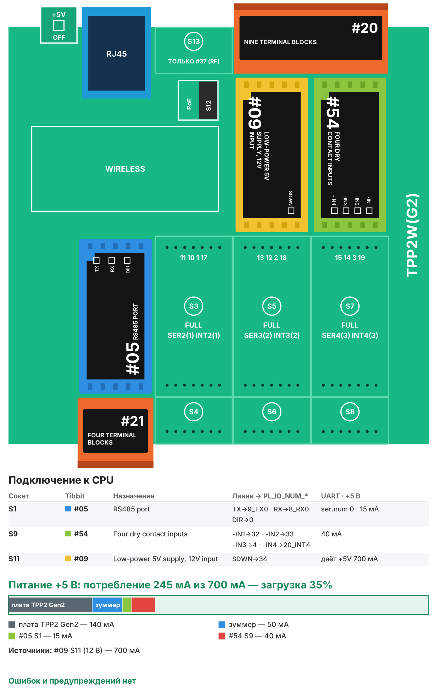

# Рецепт 03. Учёт электроэнергии и воды

Контроллер собирает показания счётчиков электроэнергии по RS-485 (Modbus RTU) и считает импульсы четырёх счётчиков воды. Показания видны на веб-странице контроллера и уходят в MQTT: в SCADA, Home Assistant, Node-RED или облако. Подходит для учёта в офисе, на небольшом производстве, в многоквартирном доме или у арендаторов.

| | |
|---|---|
| Плата | Tibbo TPP2(G2) в корпусе TPB2 |
| Входы | RS-485 (Modbus RTU, до 16 точек опроса), 4 импульсных входа «сухой контакт» |
| Выдача данных | веб-страница, MQTT 3.1.1 |
| Прошивка | Tibbo BASIC, TIDE, библиотеки 2_01_05 |
| Сборка | 50 304 байт, RAM 8 473 байт |
| Проверка | Собирается в TIDE (библиотеки 2_01_05) без ошибок и предупреждений; вариант AppBlocks открывается в редакторе без ошибок и собирается. На устройстве не проверялось |
| Лицензия | MIT |

## Что в архиве

| Файл | Что это |
|---|---|
| `tide/` | Проект TIDE. Настройки - в `config.tbh` и `config.tbs` |
| `appblocks/recipe03_metering_appblocks.json` | Вариант для AppBlocks (кнопка Import на app.appblocks.io) |
| `bom.csv` | Спецификация со ссылками на каталог tibbo.ru |
| `board.svg`, `board.png` | Раскладка Tibbit по сокетам и бюджет питания |

## Комплект

| Кол-во | Позиция | Где |
|---|---|---|
| 1 | Плата TPP2(G2), Tibbo Project PCB Size 2 Gen 2 | - |
| 1 | Корпус TPB2 для TPP2 | - |
| 1 | Tibbit #05: порт RS-485 | S1 |
| 1 | Tibbit #21: колодка на 4 клеммы | S2 |
| 1 | Tibbit #54: четыре входа «сухой контакт» | S9 |
| 1 | Tibbit #20: колодка на 9 клемм | S10+S12 |
| 1 | Tibbit #09: источник питания 5 В от 9-18 В | S11 |
| 1 | Блок питания 12 В DC на DIN-рейку, от 0,5 А | не входит в каталог Tibbo |
| 1 | Счётчик электроэнергии с интерфейсом RS-485 Modbus RTU | не входит в каталог Tibbo |
| 4 | Счётчик воды с импульсным выходом (геркон) | не входит в каталог Tibbo |

Потребление по линии +5 В - около 245 мА при запасе источника 700 мА (загрузка 35%).



**Почему TPP2(G2) и #09.** Это самая доступная плата и самый дешёвый источник питания, на которых решается задача. Свободны три M-сокета: можно добавить второй порт RS-485 (S3, S5, S7) или ещё четыре импульсных входа. В шкафу только 24 В - замените #09 на #33 (дороже, вход 8-60 В).

## Сборка

1. Вставьте Tibbit в сокеты по таблице. Ключ на корпусе Tibbit совпадает с ключом сокета.
2. Линию RS-485 счётчиков подключите к клеммам #21 в S2: A(+), B(-) и общий провод. Не работает - поменяйте A и B местами. Терминатор 120 Ом на Tibbit #05 ревизии B уже стоит.
3. Импульсные выходы счётчиков воды подключите к входам #54 (клеммы #20 в S10+S12) и земле платы (клемма 5 того же #20). Полярность геркона не важна. Счётчик с выходом «открытый коллектор» подключайте так же, минус на землю.
4. Подайте 12 В на клеммы питания того же #20 (вход Tibbit #09), подключите Ethernet.

## Настройка

- `config.tbh` - сеть, MQTT, скорость RS-485, литры на импульс и названия счётчиков воды, частота сохранения показаний.
- `config.tbs` - точки опроса счётчиков электроэнергии, как в рецепте 01:

```basic
'point_add(адрес прибора, функция, регистр, тип, делитель, "имя", можно писать)
point_add(1, 4, 342, PT_F32, 1, "meter1/energy_kwh", NO)
```

Пример настроен на карту регистров однофазного счётчика как у Eastron SDM120. Для своего счётчика возьмите адреса из его документации Modbus. Счётчики с собственным протоколом (не Modbus) этот рецепт не опрашивает.

**Показания воды.** После монтажа откройте веб-страницу и запишите текущее показание каждого счётчика в м3. Дальше контроллер прибавляет литры на каждый импульс. Показания сохраняются в энергонезависимой памяти раз в `CFG_SAVE_MINUTES` минут (по умолчанию 10) с распределением записи по 8 ячейкам, чтобы память не изнашивалась. При отключении питания теряются импульсы не больше чем за этот интервал.

## Веб-страница и MQTT

`http://<IP контроллера>/` - таблица точек Modbus, показания воды в м3 и поле «Записать» для сверки с табло. Страница обновляется сама каждые 15 с.

| Топик | Что передаётся |
|---|---|
| `tibbo/<id>/<имя точки>` | значение точки Modbus, например `1234.56` |
| `tibbo/<id>/water_cold` и другие имена из `config.tbh` | показание счётчика воды, м3 |
| `tibbo/<id>/status` | `online ok=4 err=0` после каждого цикла опроса |

## Загрузка прошивки

1. Установите [TIDE](https://tibbo.ru/downloads) и откройте `tide/metering.tpr`.
2. Поправьте `config.tbh`, нажмите F7 (сборка).
3. Выберите контроллер в Device Explorer и нажмите F5 - прошивка загрузится и запустится в режиме отладки. Для работы на объекте переключите сборку в Release и загрузите ещё раз.

## Частые проблемы

| Симптом | Что проверить |
|---|---|
| Точка «нет ответа» (ошибка 255) | A и B, скорость и чётность, адрес прибора |
| Показание воды не растёт | Зелёный светодиод входа #54 должен мигать на каждом импульсе; провод на землю - клемма 5 #20 |
| Вода считает вдвое больше | Литры на импульс в `config.tbh` (`CFG_PULSE_L1`...) |
| Показания откатились после отключения | Импульсы за последние `CFG_SAVE_MINUTES` минут не сохранены - уменьшите интервал |

## Вариант для AppBlocks

`appblocks/recipe03_metering_appblocks.json` - вариант рецепта 01 для AppBlocks плюс счётчики воды. Приборы Modbus задаются в веб-консоли устройства (таблица DEVICES), импульсы считает блок On Button Pressed, показания хранятся в настройках WATER1-WATER4 (литры, сохранение раз в 10 минут, правка - в веб-консоли), литры на импульс - настройка PULSE_L. Значения уходят в MQTT раз в минуту. Откройте app.appblocks.io → Import, проверьте вкладку Problems и нажмите Run.

Откройте app.appblocks.io → Import → выберите файл, проверьте вкладку Problems и нажмите Run.

## Доработка с Claude

Со [скиллами Tibbo для Claude](https://tibbo.ru/skills.html) проект можно менять словами:

- «Добавь в рецепт 03 суточный и месячный расход по каждому счётчику»
- «Опрашивай счётчики Меркурий по их протоколу через тот же RS-485»
- «Отправляй показания в облако раз в час одним JSON»

Скилл подберёт Tibbit, проверит питание и напишет код под эту структуру проекта.

---
Рецепт подготовил Сканкод, официальный дистрибьютор Tibbo Technology в России и СНГ. Вопросы: iot@scancode.ru, https://tibbo.ru/contacts
