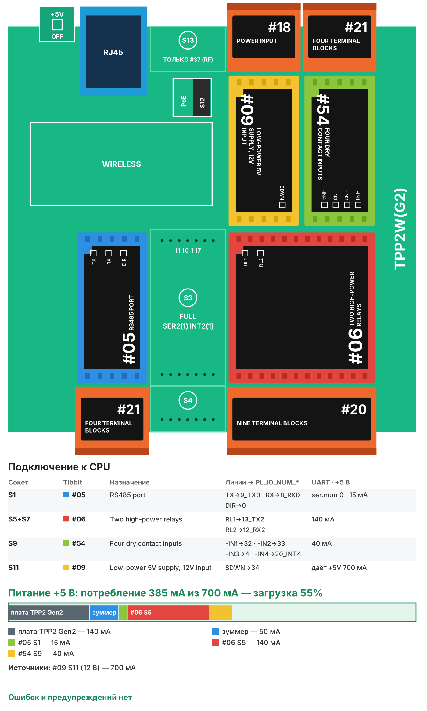

# Рецепт 04. Мониторинг серверной: температура, влажность, протечка

Контроллер следит за серверной или телекоммуникационным шкафом: температура и влажность по датчику RS-485, протечка, открытая дверь и два резервных входа (дым, работа ИБП от батарей). При тревоге включает сирену или маячок, пищит и отправляет сообщение в MQTT. Пороги меняются на веб-странице.

| | |
|---|---|
| Плата | Tibbo TPP2(G2) в корпусе TPB2 |
| Входы | датчик температуры и влажности RS-485 (Modbus RTU), 4 «сухих контакта» |
| Выходы | реле сирены, реле 2 (вручную), встроенный зуммер |
| Выдача данных | веб-страница, MQTT 3.1.1 |
| Прошивка | Tibbo BASIC, TIDE, библиотеки 2_01_05 |
| Сборка | около 53 КБ кода, около 8 КБ RAM |
| Проверка | Собирается в TIDE (библиотеки 2_01_05) без ошибок и предупреждений; вариант AppBlocks открывается в редакторе без ошибок и собирается. На устройстве не проверялось |
| Лицензия | MIT |

## Что в архиве

| Файл | Что это |
|---|---|
| `tide/` | Проект TIDE. Настройки - в `config.tbh` |
| `appblocks/recipe04_server_room_appblocks.json` | Вариант для AppBlocks (кнопка Import на app.appblocks.io) |
| `bom.csv` | Спецификация со ссылками на каталог tibbo.ru |
| `board.svg`, `board.png` | Раскладка Tibbit по сокетам и бюджет питания |

## Комплект

| Кол-во | Позиция | Где |
|---|---|---|
| 1 | Плата TPP2(G2), Tibbo Project PCB Size 2 Gen 2 | - |
| 1 | Корпус TPB2 для TPP2 | - |
| 1 | Tibbit #05: порт RS-485 | S1 |
| 1 | Tibbit #21: колодка на 4 клеммы | S2 |
| 1 | Tibbit #06: два мощных реле | S5+S7 |
| 2 | Tibbit #20: колодка на 9 клемм | S6+S8, S10+S12 |
| 1 | Tibbit #54: четыре входа «сухой контакт» | S9 |
| 1 | Tibbit #09: источник питания 5 В от 9-18 В | S11 |
| 1 | Блок питания 12 В DC на DIN-рейку, от 1 А | не входит в каталог Tibbo |
| 1 | Датчик температуры и влажности RS-485 Modbus RTU (SHT20/SHT30, например XY-MD02) | не входит в каталог Tibbo |
| 1 | Датчик протечки с выходом «сухой контакт» | не входит в каталог Tibbo |
| 1 | Магнитоконтактный датчик двери (НЗ) | не входит в каталог Tibbo |
| 1 | Сирена или светозвуковой оповещатель 12 В | не входит в каталог Tibbo |

Потребление по линии +5 В - около 385 мА при запасе источника 700 мА (загрузка 55%).

**Почему так.** Датчик температуры и влажности с RS-485 стоит дешевле Tibbit #30 и ставится там, где нужно мерить: у входа воздуха в стойку, а не внутри корпуса контроллера. Плата TPP2(G2) и источник #09 - самые доступные варианты. Нужен ещё один датчик - он встаёт на ту же линию RS-485 с другим адресом (доработка кода).

## Сборка

1. Вставьте Tibbit в сокеты по таблице.
2. Датчик температуры и влажности подключите к клеммам #21 в S2 (A, B, общий) и к 12 В. Адрес датчика по умолчанию 1, скорость 9600.
3. Входы #54 (клеммы #20 в S10+S12) и земля платы (клемма 5 того же #20): вход 1 - датчик протечки, вход 2 - датчик двери (замкнут при закрытой двери), входы 3 и 4 - резерв.
4. Сирену или маячок 12 В подключите через нормально разомкнутый контакт реле 1 (клеммы #20 в S6+S8). Реле 2 - свободное, включается с веб-страницы или по MQTT.
5. Подайте 12 В на клеммы питания #20 в S10+S12, подключите Ethernet.

## Настройка

В `config.tbh`: сеть и MQTT; адрес, функция и регистры датчика (по умолчанию - распространённые датчики на SHT20/SHT30 с Modbus RTU, например XY-MD02: функция 4, регистр 1 - температура x10, регистр 2 - влажность x10); пороги по умолчанию; задержка тревоги (`CFG_ALARM_DELAY_S`, 60 с); тип датчика двери (`CFG_DOOR_NC`); названия входов 3 и 4.

Пороги температуры и влажности меняются на веб-странице и хранятся в памяти контроллера.

## Как работает

- Порог по температуре или влажности должен быть нарушен дольше `CFG_ALARM_DELAY_S` секунд - так короткий всплеск не поднимает тревогу.
- Протечка, дверь и резервные входы срабатывают сразу (антидребезг 0,3 с).
- Нет ответа датчика дольше минуты - отдельная тревога «нет связи с датчиком».
- Тревога: реле 1 включено, зуммер пищит, красный светодиод мигает. «Квитировать» на веб-странице или по MQTT выключает сирену и зуммер до новой тревоги.

| Топик | Что передаётся |
|---|---|
| `tibbo/<id>/temperature`, `humidity` | значения с датчика |
| `tibbo/<id>/alarm` | 0 - норма, иначе сумма битов: 1 перегрев, 2 холодно, 4 влажно, 8 сухо, 16 протечка, 32 дверь, 64 и 128 входы 3 и 4, 256 нет датчика |
| `tibbo/<id>/alarm_text` | тревоги словами или `OK` |
| `tibbo/<id>/ack` (команда) | любое значение - квитировать |
| `tibbo/<id>/relay2/set` (команда) | `1` или `0` - реле 2 |

## Загрузка прошивки

1. Установите [TIDE](https://tibbo.ru/downloads) и откройте `tide/server_room_monitor.tpr`.
2. Поправьте `config.tbh`, нажмите F7 (сборка).
3. Выберите контроллер в Device Explorer и нажмите F5 - прошивка загрузится и запустится в режиме отладки. Для работы на объекте переключите сборку в Release и загрузите ещё раз.

## Частые проблемы

| Симптом | Что проверить |
|---|---|
| «нет связи с датчиком» | A и B, адрес и скорость датчика, регистры в `config.tbh` |
| Температура в 10 раз больше | Датчик отдаёт целые градусы - поменяйте делитель в `point_add` в `main.tbs` |
| Тревога «дверь открыта» при закрытой двери | `CFG_DOOR_NC` под ваш датчик |
| Сирена не звучит | Цепь: +12 В → нормально разомкнутый контакт реле 1 → сирена → 0 В |

## Вариант для AppBlocks

`appblocks/recipe04_server_room_appblocks.json` - тот же комплект, логика блоками: датчик опрашивается блоком Modbus Request раз в 5 с, тревоги пересчитываются раз в секунду, пороги и адрес датчика - настройки в веб-консоли (группа Thresholds), кнопки «Silence» и «Relay 2» - на панели устройства. В MQTT уходят тревоги при изменении и значения раз в минуту.

Откройте app.appblocks.io → Import → выберите файл, проверьте вкладку Problems и нажмите Run.

## Доработка с Claude

Со [скиллами Tibbo для Claude](https://tibbo.ru/skills.html) проект можно менять словами:

- «Добавь в рецепт 04 второй датчик температуры на адресе 2»
- «Отправляй тревоги в Telegram через MQTT-мост»
- «Выключай реле 2 (кондиционер) по расписанию с ротацией»

Скилл подберёт Tibbit, проверит питание и напишет код под эту структуру проекта.

---
Рецепт подготовил Сканкод, официальный дистрибьютор Tibbo Technology в России и СНГ. Вопросы: iot@scancode.ru, https://tibbo.ru/contacts
