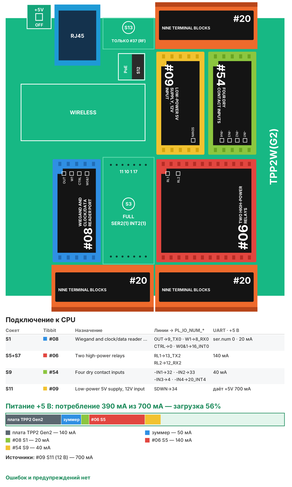

# Рецепт 05. СКУД на одну дверь

Контроллер управляет одной дверью: читает карты со считывателя Wiegand (26 или 34 бита), открывает замок для разрешённых карт и по кнопке выхода, следит за датчиком двери (взлом и «дверь не закрыта») и открывает дверь по сигналу пожарной сигнализации. Список карт и журнал - на веб-странице с паролем.

| | |
|---|---|
| Плата | Tibbo TPP2(G2) в корпусе TPB2 |
| Входы | считыватель Wiegand, кнопка выхода, датчик двери, вход пожарной сигнализации |
| Выходы | реле замка, реле сирены, встроенный зуммер |
| Карты | до 90 карт в памяти контроллера, журнал 30 последних событий |
| Прошивка | Tibbo BASIC, TIDE, библиотеки 2_01_05 |
| Сборка | 36 224 байт, RAM 10 677 байт |
| Проверка | Собирается в TIDE (библиотеки 2_01_05) без ошибок и предупреждений; вариант AppBlocks открывается в редакторе без ошибок и собирается. На устройстве не проверялось |
| Лицензия | MIT |

## Что в архиве

| Файл | Что это |
|---|---|
| `tide/` | Проект TIDE. Настройки - в `config.tbh` |
| `appblocks/recipe05_access_control_appblocks.json` | Вариант для AppBlocks (кнопка Import на app.appblocks.io) |
| `bom.csv` | Спецификация со ссылками на каталог tibbo.ru |
| `board.svg`, `board.png` | Раскладка Tibbit по сокетам и бюджет питания |

## Комплект

| Кол-во | Позиция | Где |
|---|---|---|
| 1 | Плата TPP2(G2), Tibbo Project PCB Size 2 Gen 2 | - |
| 1 | Корпус TPB2 для TPP2 | - |
| 1 | Tibbit #08: порт считывателя Wiegand | S1 |
| 3 | Tibbit #20: колодка на 9 клемм | S2+S4, S6+S8, S10+S12 |
| 1 | Tibbit #06: два мощных реле | S5+S7 |
| 1 | Tibbit #54: четыре входа «сухой контакт» | S9 |
| 1 | Tibbit #09: источник питания 5 В от 9-18 В | S11 |
| 1 | Блок питания 12 В DC с АКБ (резервированный), от 2 А | не входит в каталог Tibbo |
| 1 | Считыватель карт с выходом Wiegand 26/34, питание 12 В | не входит в каталог Tibbo |
| 1 | Электромагнитный или электромеханический замок 12 В | не входит в каталог Tibbo |
| 1 | Кнопка выхода и магнитоконтактный датчик двери | не входит в каталог Tibbo |

Потребление по линии +5 В - около 390 мА при запасе источника 700 мА (загрузка 56%). Замок и считыватель питаются от того же блока 12 В напрямую.

**Почему так.** TPP2(G2) и #09 - самые доступные плата и источник. Для замка взят Tibbit #06: он дешевле #03 и коммутирует ток замка с запасом. Блок питания с АКБ нужен, чтобы дверь работала при отключении сети.

## Сборка

1. Вставьте Tibbit в сокеты по таблице.
2. Считыватель: линии W0 и W1 - на клеммы #20 в S2+S4 по [описанию Tibbit #08](https://tibbo.ru/kb/docs/tibbit_08.html), земля считывателя - на землю системы, питание считывателя 12 В - от блока питания.
3. Замок - через реле 1 (клеммы #20 в S6+S8): электромеханический (открывается подачей питания) - через нормально разомкнутый контакт, электромагнитный (держит при питании) - через нормально замкнутый. Сирена - через реле 2.
4. Входы #54 (клеммы #20 в S10+S12, земля - клемма 5): 1 - кнопка выхода, 2 - датчик двери (замкнут при закрытой двери), 3 - выход пожарной сигнализации (замкнут = пожар).
5. Подайте 12 В на клеммы питания #20 в S10+S12, подключите Ethernet.

## Настройка

В `config.tbh`: сеть, **пароль веб-страницы** (`CFG_WEB_PASSWORD` - обязательно смените), время открытия замка, время до тревоги «дверь не закрыта», длительность сирены, наличие датчика двери и пожарного входа.

**Добавить карту:** поднесите карту к считывателю - на главной странице появится «Последняя неизвестная карта» и кнопка «Добавить». Можно ввести код вручную на странице «Карты»: для 26-битных карт в виде `123,45678` (код объекта и номер), для остальных - числом.

## Как работает

- Карта из списка или кнопка выхода - замок открыт на `CFG_UNLOCK_S` секунд, короткий сигнал зуммера. Дверь закрыли раньше - замок запирается сразу.
- Неизвестная карта - три сигнала, запись в журнал.
- Дверь открыта без карты и кнопки - тревога «взлом»: сирена на `CFG_ALARM_S` секунд.
- Дверь открыта дольше `CFG_HELD_OPEN_S` секунд - зуммер, пока её не закроют.
- Вход пожарной сигнализации замкнут - замок открыт всё время, пока есть сигнал.

Веб-страница открывается после ввода пароля, вход действует до перезагрузки контроллера. Ставьте контроллер в отдельную сеть безопасности, не в общую офисную.

## Загрузка прошивки

1. Установите [TIDE](https://tibbo.ru/downloads) и откройте `tide/access_control.tpr`.
2. Поправьте `config.tbh`, нажмите F7 (сборка).
3. Выберите контроллер в Device Explorer и нажмите F5 - прошивка загрузится и запустится в режиме отладки. Для работы на объекте переключите сборку в Release и загрузите ещё раз.

## Частые проблемы

| Симптом | Что проверить |
|---|---|
| Карта не читается («bad read») | W0 и W1 перепутаны; считыватель настроен не на Wiegand 26/34 |
| Код карты другой, чем на карте | Нормально: на карте часто напечатан десятичный номер целиком, контроллер показывает код объекта и номер |
| Замок не открывается | Тип замка и контакт реле (НО или НЗ), ток замка и блок питания |
| Тревога «взлом» при каждом проходе | Датчик двери: должен быть замкнут при закрытой двери; `CFG_DOOR_SENSOR` |

## Вариант для AppBlocks

`appblocks/recipe05_access_control_appblocks.json` - официальный пример Tibbo Access Control, переведённый на эту раскладку без дисплея. Карты хранятся в таблице user_ids со сроком действия, события - в журнале, всё видно в веб-консоли устройства. Кнопка «Open» на панели открывает дверь, «Disable Alarm» выключает сирену. Датчик двери в варианте AppBlocks опрашивается раз в секунду (у Tibbit #54 нет режима прерывания в редакторе). Вход пожарной сигнализации в варианте AppBlocks не обрабатывается - его можно добавить блоком On Variable Changed.

Откройте app.appblocks.io → Import → выберите файл, проверьте вкладку Problems и нажмите Run.

## Доработка с Claude

Со [скиллами Tibbo для Claude](https://tibbo.ru/skills.html) проект можно менять словами:

- «Добавь в рецепт 05 расписание доступа по дням недели»
- «Отправляй журнал проходов в MQTT»
- «Сделай вторую дверь на свободных сокетах»

Скилл подберёт Tibbit, проверит питание и напишет код под эту структуру проекта.

---
Рецепт подготовил Сканкод, официальный дистрибьютор Tibbo Technology в России и СНГ. Вопросы: iot@scancode.ru, https://tibbo.ru/contacts
