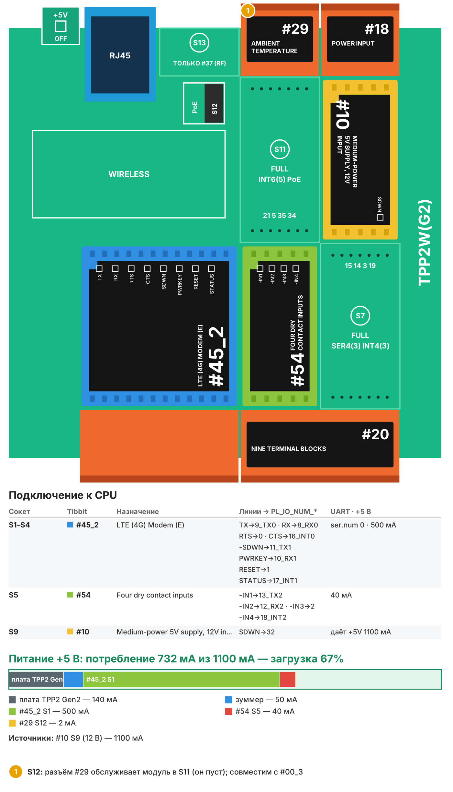

# Рецепт 07. Телеметрия удалённого объекта по LTE

Контроллер на удалённом объекте (насосная, базовая станция, шкаф автоматики, дача) передаёт состояние четырёх «сухих контактов» и температуру в шкафу через сотовую сеть LTE в MQTT-брокер. Изменение входа уходит сразу, полный отчёт - раз в 15 минут. Ethernet на объекте не нужен.

| | |
|---|---|
| Плата | Tibbo TPP2(G2) в корпусе TPB2 |
| Входы | 4 «сухих контакта»: дверь, наличие сети 220 В (через реле контроля), авария, резерв; температура в шкафу |
| Связь | LTE (Tibbit #45-2, диапазоны B1, B3, B7, B8, B20), MQTT 3.1.1 |
| Прошивка | Tibbo BASIC, TIDE, библиотеки 2_01_05 + драйверы из библиотеки Tibbo в папке `tide/libraries` |
| Сборка | 82 432 байт, RAM 14 319 байт |
| Проверка | Собирается в TIDE (библиотеки 2_01_05) без ошибок и предупреждений; вариант AppBlocks открывается в редакторе без ошибок и собирается. На устройстве не проверялось |
| Лицензия | MIT |

## Что в архиве

| Файл | Что это |
|---|---|
| `tide/` | Проект TIDE. Настройки - в `config.tbh` |
| `appblocks/recipe07_lte_telemetry_appblocks.json` | Вариант для AppBlocks (кнопка Import на app.appblocks.io) |
| `bom.csv` | Спецификация со ссылками на каталог tibbo.ru |
| `board.svg`, `board.png` | Раскладка Tibbit по сокетам и бюджет питания |

## Комплект

| Кол-во | Позиция | Где |
|---|---|---|
| 1 | Плата TPP2(G2), Tibbo Project PCB Size 2 Gen 2 | - |
| 1 | Корпус TPB2 для TPP2 | - |
| 1 | Tibbit #45-2: модем LTE (диапазоны B1, B3, B7, B8, B20) | S1-S4 |
| 1 | Tibbit #54: четыре входа «сухой контакт» | S5 |
| 1 | Tibbit #20: колодка на 9 клемм | S6+S8 |
| 1 | Tibbit #10: источник питания 5 В от 9-18 В, 1,1 А | S9 |
| 1 | Tibbit #18: разъём питания и 2 клеммы | S10 |
| 1 | Tibbit #29: датчик температуры | S12 |
| 1 | Блок питания 12 В DC на DIN-рейку, от 1,5 А | не входит в каталог Tibbo |
| 1 | Антенна LTE с разъёмом под модем Tibbit #45 | не входит в каталог Tibbo |
| 1 | SIM-карта с пакетом данных | не входит в каталог Tibbo |

Потребление по линии +5 В - около 730 мА при запасе источника 1 100 мА (загрузка 67%; для модема держим не больше 70%, пики передачи выше среднего).

**Почему так.** Модем LTE берёт много тока, поэтому вместо #09 стоит #10 (1,1 А) - это самый дешёвый источник с нужным запасом. Модем #45-2 работает в диапазонах операторов России. Tibbit #46 (LTE-M/NB-IoT) дешевле, но такие сети есть не везде - берите его, только если оператор подтвердил покрытие на объекте.

## Сборка

1. Вставьте Tibbit в сокеты по таблице. #45 занимает четыре сокета S1-S4, #29 - сокет S12 (сокет S11 оставьте свободным).
2. Подключите антенну LTE к модему, вставьте SIM-карту (PIN-код лучше отключить).
3. Входы #54 - на клеммы #20 в S6+S8 и землю платы (клемма 5 того же #20).
4. Подайте 12 В на разъём #18 в S10.

## Настройка

В `config.tbh`: APN оператора (подсказки в комментарии), логин и пароль APN, PIN-код SIM, адрес MQTT-брокера (он должен быть доступен из интернета), период отчёта, порог перегрева, названия входов.

Сотовый трафик минимальный: несколько сообщений по десятку байт при изменениях и отчёт раз в 15 минут - укладывается в любой пакет для устройств.

## Топики MQTT

| Топик | Что передаётся |
|---|---|
| `tibbo/<id>/status` | `online` при подключении |
| `tibbo/<id>/door`, `mains_ok`, `alarm`, `in4` | `1` - контакт замкнут, `0` - разомкнут; сразу при изменении |
| `tibbo/<id>/temperature` | температура в шкафу при изменении на 1 °C |
| `tibbo/<id>/overheat` | `1`, если температура выше `CFG_TEMP_HIGH` |
| `tibbo/<id>/report` | JSON со всеми значениями раз в `CFG_REPORT_MIN` минут |

Модем подключается сам после включения и переподключается при обрыве. Ход подключения виден в окне Output TIDE (debug-сборка).

## Загрузка прошивки

1. Установите [TIDE](https://tibbo.ru/downloads) и откройте `tide/lte_telemetry.tpr`.
2. Поправьте `config.tbh`, нажмите F7 (сборка).
3. Выберите контроллер в Device Explorer и нажмите F5 - прошивка загрузится и запустится в режиме отладки. Для работы на объекте переключите сборку в Release и загрузите ещё раз.

## Частые проблемы

| Симптом | Что проверить |
|---|---|
| Нет подключения к LTE | SIM-карта, PIN, APN; антенна; уровень сигнала в месте установки |
| LTE есть, MQTT нет | Брокер доступен из интернета, порт 1883 открыт, логин и пароль |
| Контроллер перезагружается при передаче | Блок питания и провод: пики тока модема до 2 А |
| Нет температуры | Tibbit #29 в S12, сокет S11 свободен |

## Вариант для AppBlocks

`appblocks/recipe07_lte_telemetry_appblocks.json` - тот же комплект в AppBlocks с включённой функцией Cellular: APN - настройка в веб-консоли (группа LTE), входы уходят в MQTT при изменении (значения как у переменных Tibbit: 0 - контакт замкнут, 1 - разомкнут), температура - раз в 5 минут, все входы повторно - раз в 15 минут. Если на объекте есть Ethernet, AppBlocks сам переключается между Ethernet и LTE.

Откройте app.appblocks.io → Import → выберите файл, проверьте вкладку Problems и нажмите Run.

## Доработка с Claude

Со [скиллами Tibbo для Claude](https://tibbo.ru/skills.html) проект можно менять словами:

- «Добавь в рецепт 07 SMS при пропадании сети 220 В»
- «Добавь счётчик моточасов насоса по входу 4»
- «Отправляй координаты GPS модема раз в час»

Скилл подберёт Tibbit, проверит питание и напишет код под эту структуру проекта.

---
Рецепт подготовил Сканкод, официальный дистрибьютор Tibbo Technology в России и СНГ. Вопросы: iot@scancode.ru, https://tibbo.ru/contacts
