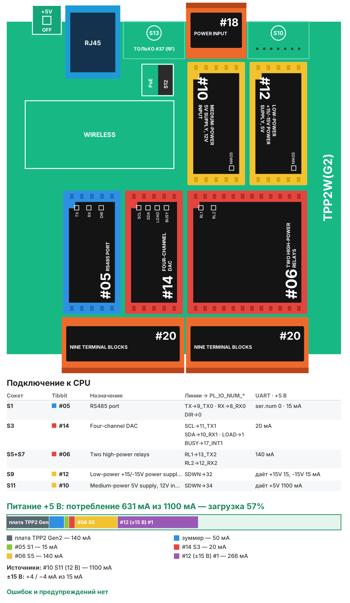

# Рецепт 08. Термостат и вентиляция (0-10 В)

Контроллер управляет климатом в помещении, теплице или вентилируемом шкафу: включает нагреватель по гистерезису, плавно открывает клапан нагрева 0-10 В и меняет скорость EC-вентилятора 0-10 В, когда становится жарко или влажно. Уставки меняются на веб-странице и по MQTT.

| | |
|---|---|
| Плата | Tibbo TPP2(G2) в корпусе TPB2 |
| Датчик | температура и влажность RS-485 (Modbus RTU) |
| Выходы | реле нагревателя, реле пуска вентилятора, 2 аналоговых выхода 0-10 В (вентилятор и клапан) |
| Режимы | авто, только вентиляция, выключено |
| Прошивка | Tibbo BASIC, TIDE, библиотеки 2_01_05 + драйверы из библиотеки Tibbo в папке `tide/libraries` |
| Сборка | около 57 КБ кода, около 8 КБ RAM |
| Проверка | Собирается в TIDE (библиотеки 2_01_05) без ошибок и предупреждений; вариант AppBlocks открывается в редакторе без ошибок и собирается. На устройстве не проверялось |
| Лицензия | MIT |

## Что в архиве

| Файл | Что это |
|---|---|
| `tide/` | Проект TIDE. Настройки - в `config.tbh` |
| `appblocks/recipe08_thermostat_appblocks.json` | Вариант для AppBlocks (кнопка Import на app.appblocks.io) |
| `bom.csv` | Спецификация со ссылками на каталог tibbo.ru |
| `board.svg`, `board.png` | Раскладка Tibbit по сокетам и бюджет питания |

## Комплект

| Кол-во | Позиция | Где |
|---|---|---|
| 1 | Плата TPP2(G2), Tibbo Project PCB Size 2 Gen 2 | - |
| 1 | Корпус TPB2 для TPP2 | - |
| 1 | Tibbit #05: порт RS-485 | S1 |
| 2 | Tibbit #20: колодка на 9 клемм | S2+S4, S6+S8 |
| 1 | Tibbit #14: четырёхканальный ЦАП ±10 В | S3 |
| 1 | Tibbit #06: два мощных реле | S5+S7 |
| 1 | Tibbit #12: источник ±15 В | S9 |
| 1 | Tibbit #10: источник питания 5 В от 9-18 В, 1,1 А | S11 |
| 1 | Tibbit #18: разъём питания и 2 клеммы | S12 |
| 1 | Блок питания 12 В DC на DIN-рейку, от 1 А | не входит в каталог Tibbo |
| 1 | Датчик температуры и влажности RS-485 Modbus RTU | не входит в каталог Tibbo |
| 1 | EC-вентилятор и/или привод клапана с входом 0-10 В | не входит в каталог Tibbo |

Потребление по линии +5 В - около 630 мА при запасе источника 1 100 мА (загрузка 57%).

**Почему так.** Выходы 0-10 В даёт только Tibbit #14, а ему обязательно нужен источник ±15 В #12 - это единственный способ получить 0-10 В на Tibbo. С #12 нагрузка на #09 выходит за 80%, поэтому питание - #10. Все шесть M-сокетов TPP2(G2) заняты; нужны ещё входы или выходы - берите TPP3(G2).

## Сборка

1. Вставьте Tibbit в сокеты по таблице.
2. Датчик RS-485 и выходы 0-10 В - на клеммы #20 в S2+S4 (A, B и общий датчика; выход 1 ЦАП - вентилятор, выход 2 - клапан, общий - земля системы). Назначение клемм - по [описанию #14](https://tibbo.ru/kb/docs/tibbit_14.html).
3. Нагреватель - через контактор или твердотельное реле, катушку которого включает реле 1 (#20 в S6+S8). Реле 2 - пуск вентилятора (разрешение EC-вентилятора).
4. Подайте 12 В на разъём #18 в S12, подключите Ethernet.

## Настройка

В `config.tbh`: сеть и MQTT, параметры датчика (по умолчанию как в рецепте 04), уставки по умолчанию, минимальная скорость вентилятора, скорость при отказе датчика.

Логика регулирования:
- **нагреватель** включается при `t < уставка - гистерезис/2` и выключается при `t > уставка + гистерезис/2`;
- **клапан** открывается от 0 % на уставке до 100 % при отклонении вниз на зону пропорциональности;
- **вентилятор** разгоняется от уставки плюс половина гистерезиса до 100 % на зоне пропорциональности; при влажности выше порога - не меньше `CFG_RH_FAN_PCT`;
- **нет данных датчика** - нагрев выключен, вентилятор на `CFG_FAIL_FAN_PCT`.

Выход 0-10 В пропорционален проценту: 50 % = 5,0 В.

## Веб-страница и MQTT

`http://<IP>/` - температура, влажность, состояние нагревателя, клапана и вентилятора, режим и уставки.

| Топик | Что передаётся |
|---|---|
| `tibbo/<id>/temperature`, `humidity` | значения датчика |
| `tibbo/<id>/heater`, `valve`, `fan`, `mode`, `setpoint` | состояние раз в 10 с |
| `tibbo/<id>/setpoint/set` (команда) | новая уставка, например `21.5` |
| `tibbo/<id>/mode/set` (команда) | `0` выкл, `1` авто, `2` вентиляция |

## Загрузка прошивки

1. Установите [TIDE](https://tibbo.ru/downloads) и откройте `tide/thermostat.tpr`.
2. Поправьте `config.tbh`, нажмите F7 (сборка).
3. Выберите контроллер в Device Explorer и нажмите F5 - прошивка загрузится и запустится в режиме отладки. Для работы на объекте переключите сборку в Release и загрузите ещё раз.

## Частые проблемы

| Симптом | Что проверить |
|---|---|
| Выходы 0-10 В молчат | Tibbit #12 в S9 обязателен для #14 |
| Нагреватель часто щёлкает | Увеличьте гистерезис |
| Вентилятор всё время на 30 % | Нет данных датчика - проверьте линию RS-485 |
| Клапан «качается» | Увеличьте зону пропорциональности |

## Вариант для AppBlocks

`appblocks/recipe08_thermostat_appblocks.json` - та же логика блоками: опрос датчика раз в 2 с, регулирование раз в секунду, уставки и режим - настройки веб-консоли (группа Thermostat), на панели - температура, влажность и стрелочные индикаторы выходов в вольтах. Ограничение 0-10 В задано минимумом и максимумом переменных fan_v и valve_v.

Откройте app.appblocks.io → Import → выберите файл, проверьте вкладку Problems и нажмите Run.

## Доработка с Claude

Со [скиллами Tibbo для Claude](https://tibbo.ru/skills.html) проект можно менять словами:

- «Замени в рецепте 08 П-регулятор клапана на ПИ»
- «Добавь ночное снижение уставки по расписанию»
- «Управляй двумя зонами с двумя датчиками на одной линии RS-485»

Скилл подберёт Tibbit, проверит питание и напишет код под эту структуру проекта.

---
Рецепт подготовил Сканкод, официальный дистрибьютор Tibbo Technology в России и СНГ. Вопросы: iot@scancode.ru, https://tibbo.ru/contacts
