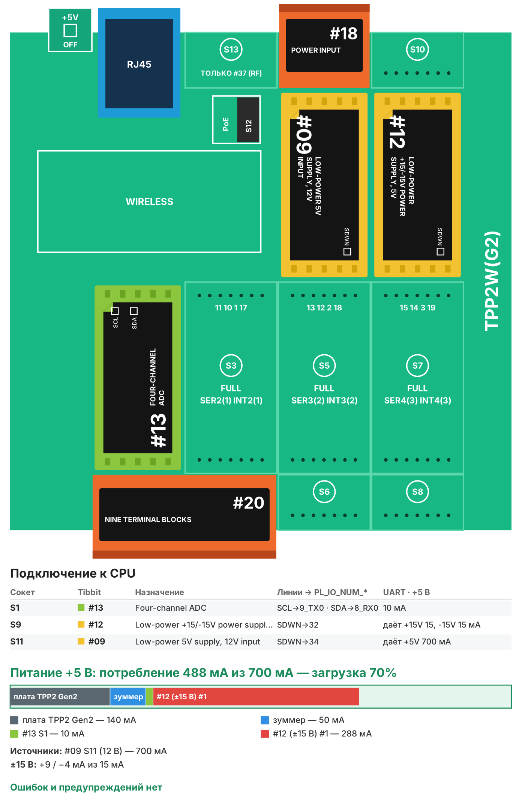

# Рецепт 09. Сбор данных 4-20 мА с веб-графиком

Контроллер собирает сигналы четырёх датчиков 4-20 мА (давление, уровень, расход, температура с нормирующим преобразователем), пересчитывает их в инженерные единицы и показывает на веб-странице с графиком за последние сутки. Данные можно скачать в CSV, средние за минуту уходят в MQTT. Обрыв датчика виден сразу.

| | |
|---|---|
| Плата | Tibbo TPP2(G2) в корпусе TPB2 |
| Входы | 4 канала 4-20 мА через шунты 250 Ом на Tibbit #13 (12 бит, ±10 В) |
| Выдача данных | веб-страница с графиком, CSV, MQTT |
| Прошивка | Tibbo BASIC, TIDE, библиотеки 2_01_05 + драйверы из библиотеки Tibbo в папке `tide/libraries` |
| Сборка | около 45 КБ кода, около 20 КБ RAM |
| Проверка | Собирается в TIDE (библиотеки 2_01_05) без ошибок и предупреждений; вариант AppBlocks открывается в редакторе без ошибок и собирается. На устройстве не проверялось |
| Лицензия | MIT |

## Что в архиве

| Файл | Что это |
|---|---|
| `tide/` | Проект TIDE. Настройки - в `config.tbh` |
| `appblocks/recipe09_4_20ma_appblocks.json` | Вариант для AppBlocks (кнопка Import на app.appblocks.io) |
| `bom.csv` | Спецификация со ссылками на каталог tibbo.ru |
| `board.svg`, `board.png` | Раскладка Tibbit по сокетам и бюджет питания |

## Комплект

| Кол-во | Позиция | Где |
|---|---|---|
| 1 | Плата TPP2(G2), Tibbo Project PCB Size 2 Gen 2 | - |
| 1 | Корпус TPB2 для TPP2 | - |
| 1 | Tibbit #13: четырёхканальный АЦП ±10 В | S1 |
| 1 | Tibbit #20: колодка на 9 клемм | S2+S4 |
| 1 | Tibbit #12: источник ±15 В | S9 |
| 1 | Tibbit #09: источник питания 5 В от 9-18 В | S11 |
| 1 | Tibbit #18: разъём питания и 2 клеммы | S12 |
| 1 | Блок питания 12 В DC на DIN-рейку, от 1 А (контроллер) | не входит в каталог Tibbo |
| 1 | Блок питания 24 В DC (питание токовых петель датчиков) | не входит в каталог Tibbo |
| 4 | Резистор 250 Ом, 0,1 %, 0,25 Вт | не входит в каталог Tibbo |

Потребление по линии +5 В - около 490 мА при запасе источника 700 мА (загрузка 70%).

**Почему так.** Связка #13 (АЦП) + #12 (±15 В) + четыре резистора 250 Ом дешевле изолированного Tibbit #53 и даёт четыре канала вместо двух. Минус - входы не изолированы: общий провод датчиков соединён с землёй контроллера. Нужна гальваническая развязка (длинные линии, разные земли) - берите #53 или #61.

**Почему #12 в S9, а не рядом с #13.** Источник ±15 В питает #13 по общей шине платы, сокет для него не важен. Ставить его в S3 под тот же #20 не стоит: у #12 нет разрешённых разъёмов, и редактор AppBlocks отмечает такую пару «Incorrect pair». В S9 #12 стоит без разъёма, как и задумано.

## Сборка

1. Вставьте Tibbit в сокеты по таблице.
2. На каждый вход #13 (клеммы #20 в S2+S4) поставьте резистор 250 Ом 0,1 % между входом и общим проводом. Ток датчика 4-20 мА превращается в напряжение 1-5 В.
3. Двухпроводный датчик: +24 В блока питания → датчик → вход #13 (резистор на общий). Общий провод блока 24 В соедините с землёй контроллера.
4. Подайте 12 В на разъём #18 в S12, подключите Ethernet.

## Настройка

В `config.tbh` для каждого канала: имя (латиница), единица и значения при 4 мА и при 20 мА в сотых долях (`CFG_LO1 = 0`, `CFG_HI1 = 1000` - датчик 0-10 бар). Сопротивление шунта - `CFG_SHUNT_OHM`.

Ток меньше 3,6 мА или больше 21 мА считается обрывом или неисправностью: канал помечается «обрыв», в MQTT уходит `fault = 1`.

## Веб-страница и MQTT

`http://<IP>/` - четыре карточки с текущими значениями и током, график выбранного канала за сутки (средние за минуту), ссылка «Скачать CSV». График хранится в памяти контроллера и начинается заново после перезагрузки - для долгого архива используйте MQTT.

| Топик | Что передаётся |
|---|---|
| `tibbo/<id>/<имя канала>` | среднее за минуту |
| `tibbo/<id>/<имя канала>/fault` | `1` при обрыве, иначе `0` |

## Загрузка прошивки

1. Установите [TIDE](https://tibbo.ru/downloads) и откройте `tide/daq_4_20.tpr`.
2. Поправьте `config.tbh`, нажмите F7 (сборка).
3. Выберите контроллер в Device Explorer и нажмите F5 - прошивка загрузится и запустится в режиме отладки. Для работы на объекте переключите сборку в Release и загрузите ещё раз.

## Частые проблемы

| Симптом | Что проверить |
|---|---|
| Все каналы «обрыв» | Нет питания петли 24 В; общий провод 24 В не соединён с землёй контроллера |
| Значения с ошибкой несколько % | Резистор не 0,1 %; значения LO/HI в сотых долях |
| Нет значений совсем | Tibbit #12 (в S9) обязателен для #13 |

## Вариант для AppBlocks

`appblocks/recipe09_4_20ma_appblocks.json` - те же каналы в AppBlocks: значения при 4 и 20 мА - настройки веб-консоли (группа Channels), карточки на панели, таблица MEASUREMENTS с записью раз в 3 минуты (500 записей, около суток) и график Time Series Chart по ней. Значения уходят в MQTT вместе с записью в таблицу.

Откройте app.appblocks.io → Import → выберите файл, проверьте вкладку Problems и нажмите Run.

## Доработка с Claude

Со [скиллами Tibbo для Claude](https://tibbo.ru/skills.html) проект можно менять словами:

- «Добавь в рецепт 09 пороги и реле тревоги на Tibbit #06»
- «Храни архив за неделю на флеш-диске контроллера»
- «Отдавай значения по Modbus TCP для SCADA»

Скилл подберёт Tibbit, проверит питание и напишет код под эту структуру проекта.

---
Рецепт подготовил Сканкод, официальный дистрибьютор Tibbo Technology в России и СНГ. Вопросы: iot@scancode.ru, https://tibbo.ru/contacts
