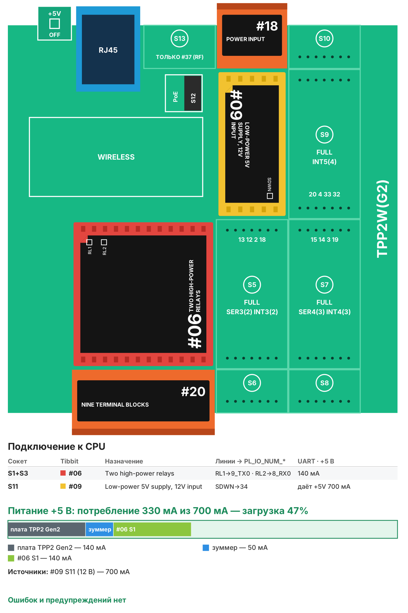

# Рецепт 10. Сторожевой узел: проверка связи и перезагрузка по питанию

Сторож следит, отвечают ли роутер, IP-камера, коммутатор или интернет. Если устройство не отвечает несколько проверок подряд, реле на несколько секунд разрывает его питание, и устройство перезагружается. После серии неудачных перезагрузок сторож делает долгую паузу, чтобы не дёргать неисправное оборудование. Подходит для удалённых объектов, где некому нажать кнопку.

| | |
|---|---|
| Плата | Tibbo TPP2(G2) в корпусе TPB2 |
| Контроль связи | TIDE: TCP-подключение к адресу и порту, до двух адресов на канал. AppBlocks: HTTP-запрос, один адрес на канал |
| Выходы | 2 реле: питание двух устройств через нормально замкнутые контакты |
| Прошивка | Tibbo BASIC, TIDE, библиотеки 2_01_05 |
| Сборка | около 28 КБ кода, около 5 КБ RAM |
| Проверка | Собирается в TIDE (библиотеки 2_01_05) без ошибок и предупреждений. Вариант AppBlocks версии 1.2.0 собран компилятором Tibbo без ошибок, логика проверена на модели по сценариям; в редакторе после правки не открывался. На устройстве не проверялось |
| Лицензия | MIT |

## Что в архиве

| Файл | Что это |
|---|---|
| `tide/` | Проект TIDE. Настройки - в `config.tbh` |
| `appblocks/recipe10_watchdog_appblocks.json` | Вариант для AppBlocks (кнопка Import на app.appblocks.io) |
| `bom.csv` | Спецификация со ссылками на каталог tibbo.ru |
| `board.svg`, `board.png` | Раскладка Tibbit по сокетам и бюджет питания |

## Комплект

| Кол-во | Позиция | Где |
|---|---|---|
| 1 | Плата TPP2(G2), Tibbo Project PCB Size 2 Gen 2 | - |
| 1 | Корпус TPB2 для TPP2 | - |
| 1 | Tibbit #06: два мощных реле | S1+S3 |
| 1 | Tibbit #20: колодка на 9 клемм | S2+S4 |
| 1 | Tibbit #09: источник питания 5 В от 9-18 В | S11 |
| 1 | Tibbit #18: разъём питания и 2 клеммы | S12 |
| 1 | Блок питания 12 В DC, от 0,5 А | не входит в каталог Tibbo |

Потребление по линии +5 В - около 330 мА при запасе источника 700 мА (загрузка 47%).

**Почему так.** Самый дешёвый комплект: TPP2(G2), один Tibbit #06 на два канала и #09. Свободно ещё три M-сокета - можно добавить каналы (второй #06) или входы.

## Сборка

1. Вставьте Tibbit в сокеты по таблице.
2. Разрежьте плюсовой провод питания устройства и заведите его через **нормально замкнутый** контакт реле (клеммы #20 в S2+S4). Пока реле выключено, питание есть; сторож включает реле, чтобы на время выключить питание. Если сторож обесточен, устройства работают как обычно.
3. Реле #06 рассчитаны на 48 В. Для устройств с питанием 230 В используйте промежуточное реле или контактор.
4. Подайте 12 В на разъём #18 в S12, подключите Ethernet в ту же сеть, что и проверяемые устройства.

## Настройка

В `config.tbh` для каждого канала - имя и до двух адресов проверки (IP и порт). Для роутера удобно проверять доступ в интернет: TCP-порт 53 серверов DNS 8.8.8.8 и 1.1.1.1. Для камеры - порт 80 или 554, для коммутатора - порт его веб-интерфейса.

Логика по умолчанию: проверка раз в 30 с, 4 неудачи подряд (2 минуты) - выключение питания на 10 с, затем 3 минуты на загрузку. После 3 перезагрузок подряд без восстановления - пауза 60 минут, затем проверки начинаются заново. Всё это - в `config.tbh` (в варианте AppBlocks - в веб-консоли, см. ниже). Сторожу лучше задать статический IP (`CFG_USE_DHCP 0`): он должен работать, даже когда роутер с DHCP завис.

## Веб-страница

`http://<IP сторожа>/` - состояние каждого канала, адреса проверки, число перезагрузок, кнопка «Перезагрузить сейчас» и журнал событий (минуты с включения сторожа).

## Загрузка прошивки

1. Установите [TIDE](https://tibbo.ru/downloads) и откройте `tide/watchdog.tpr`.
2. Поправьте `config.tbh`, нажмите F7 (сборка).
3. Выберите контроллер в Device Explorer и нажмите F5 - прошивка загрузится и запустится в режиме отладки. Для работы на объекте переключите сборку в Release и загрузите ещё раз.

## Частые проблемы

| Симптом | Что проверить |
|---|---|
| Перезагружает исправное устройство | Порт проверки закрыт на устройстве - проверьте его с ПК; увеличьте `CFG_FAILS_TO_REBOOT` |
| Не выключает питание | Питание заведено через НЗ контакт? Реле щёлкает (красный светодиод #06)? |
| После перезагрузки роутера сторож «потерялся» | Статический IP сторожа вне диапазона DHCP |

## Вариант для AppBlocks

`appblocks/recipe10_watchdog_appblocks.json` - тот же комплект, логика блоками. Сторож раз в 30 с отправляет HTTP-запрос по адресу канала. Устройство ответило - всё в порядке. После нескольких неудач подряд реле разрывает питание, а после серии перезагрузок без восстановления сторож делает долгую паузу, как в варианте TIDE.

Настройки - в веб-консоли устройства, группа Watchdog:

| Настройка | По умолчанию | Что значит |
|---|---|---|
| Channel 1: check URL, Channel 2: check URL | `http://192.168.1.1/`, `http://192.168.1.64/` | адрес проверки канала |
| Failed checks before power cycle | 4 | неудачных проверок подряд до перезагрузки: 4 по 30 с - это 2 минуты |
| Power off time, s | 10 | сколько секунд питание выключено |
| Checks to skip after power cycle | 6 | сколько проверок пропустить после перезагрузки: 6 по 30 с - это 3 минуты на загрузку |
| Power cycles in a row before long pause | 3 | перезагрузок подряд без восстановления до долгой паузы |
| Long pause, in checks | 120 | длина долгой паузы в проверках: 120 по 30 с - это 60 минут |

На панели - счётчики неудачных проверок, перезагрузок и перезагрузок подряд, кнопки «Power cycle now». Ручная перезагрузка кнопкой в счёт «подряд» не идёт.

Чем отличается от варианта TIDE:

- проверка - HTTP-запрос, поэтому у проверяемого устройства должен быть веб-интерфейс. Проверить доступ в интернет по TCP-порту 53, как в TIDE, так нельзя: укажите адрес, который отвечает по HTTP без шифрования;
- один адрес проверки на канал, а не два;
- период проверки 30 с задан в блоках On Time Period, а не в настройках;
- журнала событий нет.

Откройте app.appblocks.io → Import → выберите файл, проверьте вкладку Problems и нажмите Run.

## Доработка с Claude

Со [скиллами Tibbo для Claude](https://tibbo.ru/skills.html) проект можно менять словами:

- «Добавь в рецепт 10 третий и четвёртый канал на втором #06»
- «Отправляй уведомление в MQTT при каждой перезагрузке»
- «Проверяй доступ в интернет по HTTPS-сайту»

Скилл подберёт Tibbit, проверит питание и напишет код под эту структуру проекта.

## История версий

- **1.2.0** (13.11.2026) - вариант AppBlocks: добавлена долгая пауза после серии перезагрузок без восстановления. Раньше она была только в варианте TIDE, а описание этого не уточняло: неисправное устройство в варианте AppBlocks перезагружалось по кругу раз в 5 минут.

---
Рецепт подготовил Сканкод, официальный дистрибьютор Tibbo Technology. Вопросы: iot@scancode.ru, https://tibbo.ru/contacts
