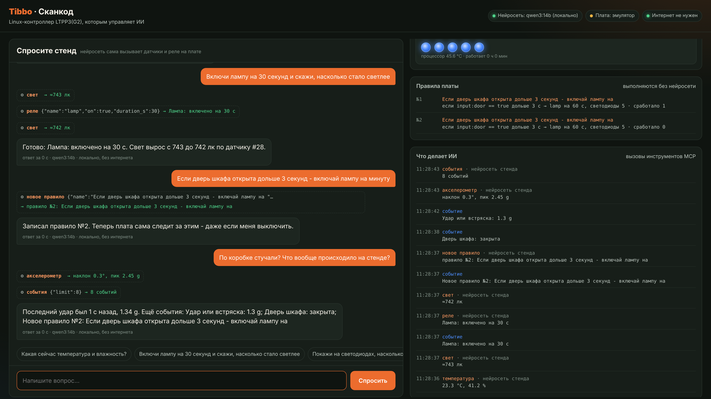

# Рецепт 11. Контроллер, с которым говорит нейросеть (MCP)

Спросите словами: «Какая температура в шкафу?», «Включи вентилятор на пять минут», «Стучали ли по коробке за последний час?» - и нейросеть сама прочитает датчики и переключит реле настоящего контроллера. А ещё ей можно сказать: «Если дверь открыта дольше 10 секунд - включай лампу на минуту», и плата будет выполнять это правило сама, даже когда нейросеть выключена. Работает с Claude, ChatGPT, DeepSeek, YandexGPT и с моделью на ноутбуке без интернета.

| | |
|---|---|
| Плата | Tibbo LTPP3(G2): Linux, сокеты для Tibbit |
| Датчики | температура и влажность (#30), освещённость (#28), акселерометр (#36), три сухих контакта (#54) |
| Выходы | 2 реле (#03-1): лампа и вентилятор 12 В |
| Протокол | MCP (Model Context Protocol): его понимают приложения нейросетей и ИИ-агенты |
| Программа | Python 3.9+ без сторонних библиотек; на плату ничего не ставится через pip |
| Проверка | 27 автотестов на эмуляторе платы, официальный MCP-клиент Python SDK. **На настоящей LTPP3(G2) не запускалось** |
| Статус | бета |
| Лицензия | MIT |

## Что в архиве

| Файл | Что это |
|---|---|
| `stand/tibbo_mcp/` | Сервер MCP, работа с железом, правила, веб-панель, агент |
| `stand/config.example.json` | Настройки: стенд без интернета |
| `stand/config.cloud.example.json` | Облачная нейросеть с запасной локальной |
| `stand/config.hub.example.json` | Несколько плат под одной нейросетью |
| `stand/deploy/` | Установка службой systemd на плату |
| `stand/tools/mock_ollama.py` | Заглушка нейросети для проверки без модели |
| `stand/tests/` | Автотесты |
| `stand/docs/providers.md` | Готовые настройки для 11 сервисов и локальных моделей |
| `bom.csv` | Спецификация со ссылками на каталог tibbo.ru |
| `panel.png` | Как выглядит веб-панель |

Свежая версия - на GitHub: https://github.com/SCANCODE-IOT/tibbo-mcp-stand

## Комплект

| Кол-во | Позиция | Сокеты |
|---|---|---|
| 1 | Плата LTPP3(G2) | - |
| 3 | Tibbit #00-3 - прямое подключение линий | S3, S5, S7 |
| 1 | Tibbit #30 - температура и влажность | S4 |
| 1 | Tibbit #28 - освещённость | S6 |
| 1 | Tibbit #36 - акселерометр | S8 |
| 1 | Tibbit #03-1 - два реле | S9 |
| 1 | Tibbit #54 - четыре входа «сухой контакт» | S11 |
| 2 | Tibbit #21 - 4 клеммы | S10, S12 |

Источник питания у LTPP3(G2) встроенный, на 8-60 В: Tibbit-источники не нужны. Отдельно понадобятся: адаптер 12 В / 2 А, лампа и вентилятор на 12 В, грибок аварийной остановки, геркон, кнопка. Для насоса или мотора вместо #03-1 берите #06: у него запас по пусковому току.

Автоматической проверки раскладки для LTPP3(G2) нет: её нет в конфигураторе TPS. Раскладка составлена по документации платы.



## Попробовать за 2 минуты без железа

Нужен компьютер с Python 3.9 или новее.

```
cd stand
python3 tools/mock_ollama.py --port 11434 &
python3 -m tibbo_mcp --sim --listen 127.0.0.1:8080
```

Откройте http://127.0.0.1:8080/. Это эмулятор: лампа светит в датчик света, вентилятор охлаждает шкаф, на панели есть кнопки «Постучать по коробке», «Дверь», «Аварийная кнопка». В Windows вместо `python3` пишите `python`, а заглушку запустите в отдельном окне.

## На плате

```
python3 -m tibbo_mcp --probe     # ищет шины I2C и датчики
sh deploy/install.sh             # ставит в /opt/tibbo-stand и запускает службу
```

Нейросеть на плату не помещается (у LTPP3(G2) 512 МБ памяти): она работает в облаке или на ноутбуке рядом. Четыре режима - стенд без интернета, облачная нейросеть с запасной локальной, плата как инструмент в приложении нейросети, несколько плат под одной нейросетью - описаны в `stand/README.ru.md`.

## Что умеет нейросеть

| Инструмент | Что делает |
|---|---|
| `read_climate`, `read_light`, `read_motion`, `read_inputs` | читает датчики и входы |
| `set_relay` | включает лампу или вентилятор, всегда с таймером |
| `create_rule`, `list_rules`, `delete_rule` | правила, которые плата выполняет сама |
| `recent_events`, `stand_status` | журнал и состояние |
| `check_tps_config`, `find_tibbit`, `lint_tibbo_code` | проверка плат и кода Tibbo (нужны [скиллы Tibbo](https://tibbo.ru/skills.html)) |

## Защиты

- Реле включаются только с таймером, не дольше 10 минут, и не чаще раза в 2 секунды.
- Аварийная кнопка на входе #54 выключает всю нагрузку и запрещает включение.
- Режим «только чтение»: нейросеть видит датчики, но ничего не включает. Для запросов из интернета он включён по умолчанию.
- При остановке программы все реле выключаются.

## Что не проверено на железе

Номера шин I²C, нумерация линий из `pins.ini`, полярность реле и входов, модуль светодиодов платы и версия Python в образе LTPP3(G2). Первый запуск начните с `--probe` и пришлите нам его вывод: iot@scancode.ru или issue на GitHub.

## Доработка с Claude

- «Добавь инструмент, который читает счётчик по Modbus через Tibbit #05»
- «Сделай правило с условием по времени суток»
- «Переведи панель на английский»

---
Рецепт подготовил Сканкод, официальный дистрибьютор Tibbo Technology в России и СНГ. Вопросы: iot@scancode.ru, https://tibbo.ru/contacts
