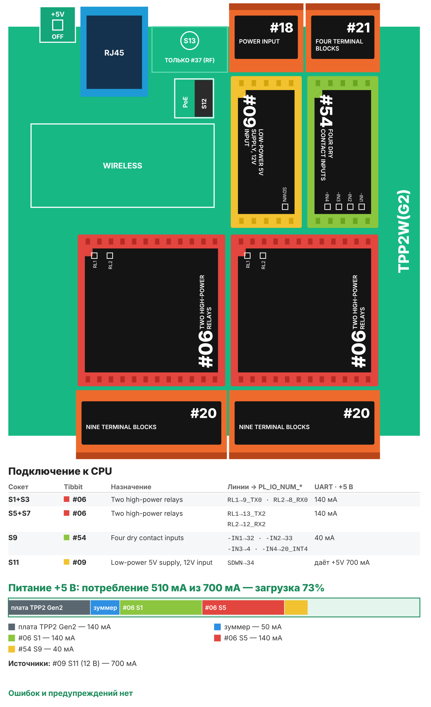

# Рецепт 12. Андон: световая колонна и учёт простоев станка

Оператор нажимает кнопку - над станком загорается жёлтый или красный свет, и мастер видит это с другого конца цеха. Контроллер в это время считает: сколько минут станок работал, сколько ждал помощи, сколько стоял в аварии, сколько было остановок и сколько деталей сделано за смену. Всё видно на веб-странице контроллера, итоги прошлой смены сохраняются. Подходит для станка, упаковочной линии, сборочного поста.

| | |
|---|---|
| Плата | Tibbo TPP2(G2) в корпусе TPB2 |
| Выходы | 4 реле (два Tibbit #06): зелёный, жёлтый, красный свет колонны и сирена |
| Входы | 4 сухих контакта (Tibbit #54): кнопки «Работа», «Вызов», «Авария» и датчик цикла (счёт деталей) |
| Управление | кнопки на посту и те же команды на веб-странице контроллера |
| Питание | 12 В DC (Tibbit #09) |
| Прошивка | проект AppBlocks (TiOS), в архиве есть и сгенерированный из него проект TIDE |
| Проверка | Проект AppBlocks проходит проверку без ошибок и предупреждений и собирается компилятором Tibbo (сборщик AppBlocks, ноябрь 2026). На устройстве не проверялось |
| Лицензия | MIT |

## Что в архиве

| Файл | Что это |
|---|---|
| `appblocks/recipe12_andon_appblocks.json` | Проект AppBlocks (кнопка Import на app.appblocks.io) |
| `appblocks/flow.svg` | Схема логики: четыре группы блоков |
| `tide/` | Проект TIDE, который AppBlocks сгенерировал из этого проекта. Для тех, кто работает без AppBlocks |
| `bom.csv` | Спецификация со ссылками на каталог tibbo.ru |
| `board.svg`, `board.png` | Раскладка Tibbit по сокетам и бюджет питания |

## Комплект

| Кол-во | Позиция | Сокет |
|---|---|---|
| 1 | Плата TPP2(G2) | - |
| 1 | Корпус TPB2 | - |
| 2 | Tibbit #06 - два мощных реле | S1+S3 (зелёный, жёлтый), S5+S7 (красный, сирена) |
| 2 | Tibbit #20 - 9 клемм | S2+S4 и S6+S8 (контакты реле) |
| 1 | Tibbit #54 - четыре входа «сухой контакт» | S9 |
| 1 | Tibbit #21 - 4 клеммы | S10 (кнопки и датчик цикла) |
| 1 | Tibbit #09 - источник 5 В от 9-18 В | S11 |
| 1 | Tibbit #18 - разъём питания и 2 клеммы | S12 (вход 12 В) |

Отдельно понадобятся: блок питания 12 В на DIN-рейку от 1 А, световая колонна с сиреной на 12 или 24 В, три кнопки без фиксации, датчик цикла с выходом «сухой контакт» (концевик, геркон или датчик с релейным выходом).

Потребление по линии +5 В - 510 мА при источнике 700 мА (загрузка 73 %).

**Почему так.** Это тот же комплект, что в рецепте 02 «Управление освещением»: его можно перепрошить из одного решения в другое. Реле #06 взяты с запасом: лампы колонны и сирена дают бросок тока при включении. Кнопки стоят на защищённых входах #54.

## Как работает

- **«Работа»** - горит зелёный. Идёт счёт минут работы.
- **«Вызов»** - горит жёлтый: нет материала, нужен наладчик или контролёр. Идёт счёт минут ожидания.
- **«Авария»** - горит красный, сирена звучит 10 секунд и замолкает сама. Идёт счёт минут аварии.
- Переход из «Работы» в «Вызов» или «Аварию» считается остановкой.
- Каждое срабатывание датчика цикла - плюс одна деталь.
- В 08:00 и 20:00 смена закрывается сама: итоги записываются в память «прошлая смена» (сохраняются при отключении питания), счётчики обнуляются. Время смен меняется в AppBlocks: Features → Scheduler. Закрыть смену можно и кнопкой на веб-странице.

Счётчики текущей смены хранятся в оперативной памяти и при отключении питания обнуляются. Так сделано нарочно: запись во флеш каждую минуту изнашивает память.

## Сборка

1. Вставьте Tibbit в сокеты по таблице.
2. Колонна: общий плюс питания ламп - на общие контакты реле, каждая лампа и сирена - через **нормально разомкнутый** контакт своего реле. Номера клемм покажет AppBlocks: панель Device → переключатель Wiring.
3. Кнопки и датчик цикла - между входом #54 и землёй (клеммы #21 в S10).
4. Реле #06 рассчитаны на низковольтные цепи. Нагрузку 230 В включайте через промежуточное реле или контактор.
5. Подайте 12 В на разъём #18 в S12, подключите Ethernet.

Если кнопка «Авария» должна останавливать станок, это делает цепь безопасности станка, а не этот контроллер: андон только показывает и считает.

## Загрузка прошивки

1. Откройте app.appblocks.io → Import → выберите `appblocks/recipe12_andon_appblocks.json`.
2. Проверьте вкладку Problems (должна быть пустой) и нажмите Run. Для загрузки нужна программа Tibbo Desktop Extension на компьютере в одной сети с контроллером.
3. Адрес контроллера по умолчанию выдаёт роутер (DHCP). Откройте `http://<адрес контроллера>/` - это веб-панель.

Без AppBlocks: откройте `tide/project.tpr` в TIDE, соберите (F7) и загрузите (F5).

## Веб-панель

Верхний ряд - состояние и счётчики текущей смены, средний - кнопки «Работа», «Вызов», «Авария», «Новая смена», нижний - итоги прошлой смены. Подписи на панели английские: кириллицу в панели AppBlocks на устройстве мы не проверяли. Пароль панели задаётся в её настройках (General → Web Admin Password).

## Частые проблемы

| Симптом | Что проверить |
|---|---|
| При включении питания на секунду загораются все лампы | Реле #06 включаются уровнем LOW. Проверьте, что лампы подключены через нормально разомкнутые контакты |
| Детали считаются с пропусками | Датчик даёт слишком короткий импульс. Возьмите датчик с релейным выходом или удлините импульс |
| Смена не закрывается сама | Контроллеру нужно точное время: проверьте доступ в интернет (SNTP) и часовой пояс в настройках панели |
| Счётчики обнулились | Было отключение питания: счётчики текущей смены хранятся в оперативной памяти |

## Доработка с Claude

Со [скиллами Tibbo для Claude](https://tibbo.ru/skills.html) проект можно менять словами:

- «Добавь в рецепт 12 отправку состояния и счётчиков в MQTT»
- «Сделай три смены: с 7, с 15 и с 23 часов»
- «Считай плановую выработку и показывай отставание от плана»

Скилл поправит проект AppBlocks, проверит его и соберёт прошивку.

---
Рецепт подготовил Сканкод, официальный дистрибьютор Tibbo Technology. Вопросы: iot@scancode.ru, https://tibbo.ru/contacts
