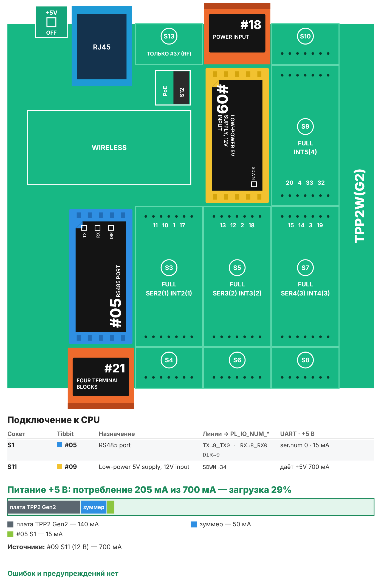

# Рецепт 13. Чёрный ящик RS-485: что было на линии перед сбоем

Счётчик раз в сутки «отваливается», датчик иногда отвечает ерунду, а когда приезжает наладчик, всё работает. Чёрный ящик подключается к линии RS-485 параллельно, молча слушает обмен и держит в памяти последние 150 кадров. В момент сбоя - кадр с неверной контрольной суммой, ответ-исключение Modbus или тишина на линии - он замораживает снимок. На веб-странице видно, что именно шло по линии за секунды до сбоя: каждый кадр со временем в миллисекундах.

| | |
|---|---|
| Плата | Tibbo TPP2(G2) в корпусе TPB2 |
| Линия | RS-485 (Tibbit #05), только приём: контроллер ничего не передаёт и не мешает обмену |
| Протокол | Modbus RTU: кадры делятся по контрольной сумме, определяются исключения. Другие протоколы - см. «Настройка» |
| Память | 150 последних кадров и снимок перед сбоем - в оперативной памяти |
| Питание | 12 В DC (Tibbit #09) |
| Прошивка | Tibbo BASIC, проект TIDE; библиотеки sock и dhcp лежат в папке проекта |
| Сборка | около 33 КБ кода |
| Проверка | Собирается компилятором TIDE без ошибок (сборщик Tibbo, ноябрь 2026). Деление потока на кадры проверено моделью: 200 000 случайных порций без ложных делений, одиночная ошибка в бите замечена в 20 000 случаев из 20 000. На устройстве не проверялось |
| Лицензия | MIT |

## Что в архиве

| Файл | Что это |
|---|---|
| `tide/` | Проект TIDE. Настройки - в `config.tbh` |
| `bom.csv` | Спецификация со ссылками на каталог tibbo.ru |
| `board.svg`, `board.png` | Раскладка Tibbit по сокетам и бюджет питания |

Варианта для AppBlocks нет: разбор потока по контрольной сумме с точным временем блоками не собрать.

## Комплект

| Кол-во | Позиция | Сокет |
|---|---|---|
| 1 | Плата TPP2(G2) | - |
| 1 | Корпус TPB2 | - |
| 1 | Tibbit #05 - порт RS-485 | S1 |
| 1 | Tibbit #21 - 4 клеммы | S2 (линия A, B и земля) |
| 1 | Tibbit #09 - источник 5 В от 9-18 В | S11 |
| 1 | Tibbit #18 - разъём питания и 2 клеммы | S12 (вход 12 В) |

Отдельно понадобится блок питания 12 В от 0,5 А.

Потребление по линии +5 В - 205 мА при источнике 700 мА (загрузка 29 %).

**Почему так.** Это тот же комплект, что в рецепте 01 «Шлюз Modbus RTU → MQTT». Один контроллер можно прошить шлюзом, а на время поиска неисправности - чёрным ящиком.

## Как работает

1. Контроллер принимает всё, что идёт по линии. Запрос и быстрый ответ обычно приходят одной порцией, поэтому поток делится на кадры по контрольной сумме: CRC-16 кадра вместе с его двумя байтами суммы равна нулю. Длина кадра сверяется с кодом функции Modbus, чтобы случайное совпадение посреди длинного ответа не приняли за конец кадра.
2. Каждый кадр получает время в миллисекундах и попадает в кольцо из 150 записей. Хранятся первые 24 байта кадра и его полная длина.
3. Сбой - это кадр без верной суммы, ответ с кодом функции 0x80 и выше (исключение Modbus) или тишина дольше 30 секунд после того, как обмен шёл.
4. При первом сбое кольцо копируется в снимок, мигает красный светодиод. Снимок не затирается, пока вы не снимете его на веб-странице; сбои, случившиеся после, считаются.
5. Отдельно ведётся список адресов устройств на линии: сколько кадров и сколько исключений у каждого.

## Сборка

1. Вставьте Tibbit в сокеты по таблице.
2. Подключите клеммы #21 в S2 к линии RS-485 **параллельно**, в любом месте: A к A, B к B, земля к земле. Назначение клемм покажет AppBlocks (Device → Wiring) или страница [Tibbit #05](https://tibbo.ru/kb/docs/tibbit_05.html).
3. Терминатор на чёрный ящик не ставьте: он не крайнее устройство линии.
4. Подайте 12 В на разъём #18 в S12, подключите Ethernet.

## Настройка

В `config.tbh`:

- `CFG_RS485_BAUD`, `CFG_RS485_PARITY` - скорость и чётность, как у устройств на линии;
- `CFG_TRIG_CRC`, `CFG_TRIG_EXCEPTION`, `CFG_TRIG_SILENCE_S` - по каким сбоям замораживать снимок;
- `CFG_USE_DHCP` и адрес - сеть.

Если на линии не Modbus RTU, поставьте `CFG_TRIG_CRC 0` и `CFG_TRIG_EXCEPTION 0`: кадры будут делиться по паузам от 10 мс, а снимок останется по тишине и вручную.

## Веб-страница

`http://<IP контроллера>/` - счётчики (кадры, ошибки CRC, исключения, тишина), снимок перед сбоем со временем «миллисекунд до сбоя», последние 30 кадров, адреса на линии. Кнопки: «Сделать снимок сейчас», «Снять снимок и ждать следующий сбой», «Очистить всё». Таблицу можно выделить и вставить в Excel.

## Загрузка прошивки

1. Установите [TIDE](https://tibbo.ru/downloads) и откройте `tide/blackbox.tpr`.
2. Поправьте `config.tbh`, нажмите F7 (сборка).
3. Выберите контроллер в Device Explorer и нажмите F5. Для работы на объекте переключите сборку в Release и загрузите ещё раз.

## Ограничения

- Снимок и кольцо хранятся в оперативной памяти: при отключении питания они пропадают. Время - от включения контроллера, а не календарное.
- Пауза между кадрами измеряется с шагом 10 мс: это ограничение события приёма в TiOS.
- От кадра длиннее 24 байт хранится начало и полная длина.
- Перепутанные A и B или неверная скорость выглядят как сплошные ошибки CRC.

## Частые проблемы

| Симптом | Что проверить |
|---|---|
| Все кадры с пометкой «нет верной CRC» | Скорость и чётность в `config.tbh`; не перепутаны ли A и B |
| Снимок появляется сразу после включения | На линии не Modbus RTU - отключите `CFG_TRIG_CRC` |
| Кадров нет совсем | Клеммы подключены к той же паре проводов? Есть ли обмен в этот момент? |
| Растёт счётчик переполнений буфера | Очень плотный обмен на высокой скорости: увеличьте `ser.rxbuffrq` в `bus.tbs` |

## Доработка с Claude

Со [скиллами Tibbo для Claude](https://tibbo.ru/skills.html) проект можно менять словами:

- «Сохраняй снимок во флеш, чтобы он пережил отключение питания»
- «Добавь в рецепт 13 календарное время по SNTP»
- «Отправляй снимок в MQTT или на почту при сбое»

Скилл напишет код под эту структуру проекта и проверит его компилятором.

## История версий

- **1.0.1** (13.11.2026) - веб-страница: первый параметр запроса не распознавался, поэтому кнопки и сохранение настроек на странице могли не срабатывать. Теперь строка запроса разбирается так, как её отдаёт TiOS (без «?» в начале).
- **1.0.0** (13.11.2026) - первая версия.

---
Рецепт подготовил Сканкод, официальный дистрибьютор Tibbo Technology. Вопросы: iot@scancode.ru, https://tibbo.ru/contacts
