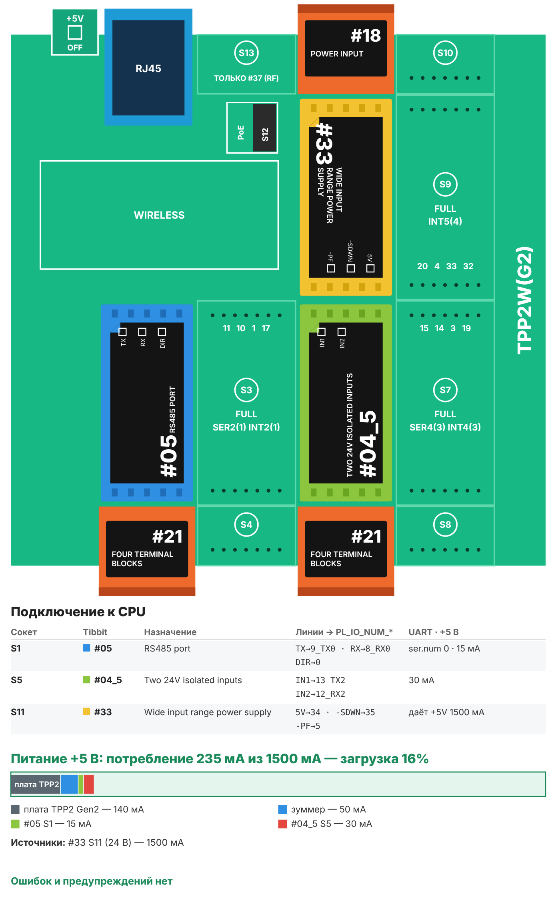

# Рецепт 14. Сварочный пост: учёт времени работы сварщика

Контроллер по току аппарата видит, когда горит дуга, и сам ведёт учёт поста: сколько времени шла сварка, сколько сварщик был в работе, сколько раз зажигал дугу, когда начал и когда закончил. Счётчик электроэнергии добавляет киловатт-часы за сутки. Сварщику ничего нажимать не нужно: ни карт, ни кнопок. Итоги по суткам видны на веб-странице, выгружаются в CSV и уходят в MQTT.

| | |
|---|---|
| Плата | Tibbo TPP2(G2) в корпусе TPB2 |
| Датчик дуги | реле тока на питающем кабеле аппарата, изолированный вход 24 В (Tibbit #04-5) |
| Энергия | счётчик электроэнергии с RS-485 Modbus RTU (Tibbit #05), можно без него |
| Учёт | время дуги, время в работе, число зажиганий, начало и конец работы, кВт·ч - за сутки; журнал на 62 дня |
| Выдача данных | веб-страница, CSV, MQTT 3.1.1 |
| Питание | 24 В DC (Tibbit #33) |
| Прошивка | Tibbo BASIC, TIDE, библиотеки 2_01_05 |
| Сборка | около 70 КБ кода |
| Проверка | Проект TIDE и вариант AppBlocks собраны компилятором Tibbo без ошибок (ноябрь 2026), TIDE - во всех вариантах настроек. Логика учёта обоих вариантов проверена на модели по сценариям. Вариант AppBlocks в редакторе не открывался. На устройстве не проверялось |
| Лицензия | MIT |

## Что в архиве

| Файл | Что это |
|---|---|
| `tide/` | Проект TIDE. Настройки - в `config.tbh` |
| `appblocks/recipe14_welding_post_appblocks.json` | Вариант для AppBlocks (кнопка Import на app.appblocks.io) |
| `bom.csv` | Спецификация со ссылками на каталог tibbo.ru |
| `board.svg`, `board.png` | Раскладка Tibbit по сокетам и бюджет питания |

## Комплект

| Кол-во | Позиция | Где |
|---|---|---|
| 1 | Плата TPP2(G2), Tibbo Project PCB Size 2 Gen 2 | - |
| 1 | Корпус TPB2 для TPP2 | - |
| 1 | Tibbit #04-5: два изолированных входа 24 В | S5 |
| 1 | Tibbit #05: порт RS-485 | S1 |
| 2 | Tibbit #21: колодка на 4 клеммы | S2 (RS-485), S6 (входы #04-5) |
| 1 | Tibbit #33: источник питания 5 В от 8-60 В | S11 |
| 1 | Tibbit #18: разъём питания и 2 клеммы | S12 |
| 1 | Блок питания 24 В DC на DIN-рейку, от 1 А | не входит в каталог Tibbo |
| 1 | Реле контроля тока на кабель (с разъёмным сердечником, настраиваемым порогом и выходом «сухой контакт» или транзисторным) | не входит в каталог Tibbo |
| 1 | Счётчик электроэнергии с RS-485 Modbus RTU на ток аппарата | не входит в каталог Tibbo |

Потребление по линии +5 В - около 235 мА при запасе источника 1 500 мА (загрузка 16%).

**Почему так.** Главное здесь - надёжность рядом со сваркой, поэтому комплект не самый дешёвый.

- **Датчик стоит на питающем кабеле аппарата, а не на сварочном.** Реле тока надевается на фазный провод 230/400 В и не имеет связи со сварочной цепью. Так можно учитывать любой аппарат: трансформатор, инвертор, полуавтомат, аргон.
- **Вход - изолированный, на 24 В (#04-5).** Оптрон отделяет контроллер от линии датчика, а сигнал 24 В помехи сбивают хуже, чем сигнал 5 В. Tibbit #54 «сухой контакт» дешевле на несколько долларов, но его входы не изолированы.
- **Источник #33 вместо #09.** Он дороже, но выдерживает провалы питания до 6 В и выбросы до 100 В, а в сварочном цехе сеть «гуляет». У него есть выход «питание пропадает»: по нему контроллер успевает сохранить счётчики. Питание 24 В - обычное для щитов.

**Вариант «эконом».** Блок питания 12 В, источник #09 и входы #54 вместо #04-5 (в том же сокете S5). Прошивка TIDE та же, в `config.tbh` поставьте `CFG_POWER_FAIL_INPUT 0`. Чем платите: вход не изолирован, сигнал 5 В чувствительнее к помехам, нет сохранения счётчиков при сбое питания (остаётся сохранение раз в 5 минут). Для поста рядом с мощным аппаратом не советуем.

## Как считает

- **Дуга.** Ток в кабеле держится дольше 50 мс - дуга зажглась. Тока нет дольше 0,5 с - дуга погасла. Короткий провал тока внутри шва новым зажиганием не считается.
- **Время дуги** - сколько секунд за сутки горела дуга. Считается с шагом 10 мс.
- **Время в работе** - время дуги плюс паузы между швами короче 15 минут: сварщик зачищает, меняет электрод, переставляет деталь. Пауза длиннее 15 минут считается перерывом и в работу не идёт.
- **Зажигания** - сколько раз за сутки зажигалась дуга. По ним видно характер работы: длинные швы или прихватки.
- **Доля дуги** - время дуги, делённое на время в работе.
- **Энергия** - разница показаний счётчика с начала суток.
- **Сутки** закрываются в полночь (или в час, заданный в настройках, если смена ночная). Итог уходит в журнал, счётчики обнуляются. Сутки без сварки в журнал не попадают.

Счётчики текущих суток сохраняются в память раз в 5 минут и при сигнале источника «питание пропадает». После перезагрузки учёт продолжается с сохранённых значений.

## Сборка

1. Вставьте Tibbit в сокеты по таблице. Ключ на корпусе Tibbit совпадает с ключом сокета.
2. Наденьте реле тока на один фазный провод кабеля, которым аппарат подключён к сети. Не на весь кабель целиком и не на сварочный кабель.
3. Цепь датчика: +24 В блока питания → контакт реле тока → вход 1 Tibbit #04-5 (клеммы #21 в S6) → 0 В. У входа есть полярность. Номера клемм покажет AppBlocks (панель Device → Wiring) или страница [Tibbit #04-5](https://tibbo.ru/kb/docs/tibbit_04-5.html).
4. Настройте порог реле тока: выше тока холостого хода аппарата (вентилятор, электроника) и ниже тока при сварке на самом малом режиме. Проверка: при зажигании дуги загорается зелёный светодиод входа на #04-5.
5. Счётчик электроэнергии поставьте на линию питания аппарата. Линию RS-485 счётчика подключите к клеммам #21 в S2: A, B и общий провод. Не работает - поменяйте A и B местами.
6. Подайте 24 В на разъём #18 в S12 (на клеммы или на джек, не одновременно), подключите Ethernet.

Работы в силовом щите выполняет электрик с допуском. Контроллер и блок питания ставьте в отдельный металлический шкаф, провод датчика ведите отдельно от сварочных кабелей. Вход 2 Tibbit #04-5 свободен.

## Настройка

Всё в `tide/config.tbh`:

- сеть и MQTT;
- `CFG_NTP_SERVER`, `CFG_TZ_MINUTES` - сервер времени (нужен именно IP) и часовой пояс;
- `CFG_DAY_START_MIN` - начало учётных суток: 0 - полночь, 480 - 08:00;
- `CFG_BREAK_MIN` - пауза, после которой начинается перерыв (15 минут);
- `CFG_ARC_ON_MS`, `CFG_ARC_OFF_MS` - защита от помех и провалов тока;
- `CFG_METER_ADDR`, `CFG_REG_ENERGY`, `CFG_REG_POWER` - адрес и регистры счётчика. По умолчанию - карта Eastron: энергия 342, мощность 12 (однофазный SDM120) или 52 (трёхфазный SDM630). Для другого счётчика возьмите номера из его документации;
- `CFG_USE_METER 0` - если счётчика нет: останется учёт времени;
- `CFG_ARC_SOURCE 1` - если нет реле тока: дуга определяется по мощности счётчика выше `CFG_ARC_POWER_W`. Точность тогда около секунды, короткие прихватки могут не попасть в счёт.

## Веб-страница и MQTT

`http://<IP контроллера>/` - состояние (дуга горит, в работе, перерыв), счётчики текущих суток, журнал за последние 14 суток, ссылка на CSV со всеми сутками, установка часов. Страница обновляется сама раз в 10 секунд.

`<id>` - MAC-адрес контроллера в hex.

| Топик | Что передаётся |
|---|---|
| `tibbo/<id>/arc` | `1` - дуга горит, `0` - нет; сразу при изменении |
| `tibbo/<id>/arc_s` | время дуги с начала суток, секунды; раз в минуту |
| `tibbo/<id>/work_min` | время в работе с начала суток, минуты; раз в минуту |
| `tibbo/<id>/starts` | зажиганий с начала суток; раз в минуту |
| `tibbo/<id>/kwh_day`, `power_w` | энергия с начала суток и мощность сейчас; раз в минуту |
| `tibbo/<id>/day` | итог закрытых суток одним сообщением JSON |
| `tibbo/<id>/status` | `online` или `online, no meter` |

Веб-страница без пароля: ставьте контроллер в технологическую сеть, а не в общую сеть с гостевым Wi-Fi.

## Загрузка прошивки

1. Установите [TIDE](https://tibbo.ru/downloads) и откройте `tide/welding_post.tpr`.
2. Поправьте `config.tbh`, нажмите F7 (сборка).
3. Выберите контроллер в Device Explorer и нажмите F5 - прошивка загрузится и запустится в режиме отладки. Для работы на объекте переключите сборку в Release и загрузите ещё раз.

## Индикация

| Светодиод | Что значит |
|---|---|
| Зелёный на плате горит | дуга горит |
| Зелёный на плате, короткая вспышка | контроллер работает, дуги нет |
| Красный на плате, короткая вспышка | часы не установлены: сутки не закрываются |
| Зелёный на #04-5 | ток в кабеле выше порога реле тока |

## Ограничения

- Контроллер считает работу поста, а не человека: кто именно варил, он не знает. Если на посту в сутки работают двое, их время сложится.
- Учёт идёт по току аппарата. Подготовка без дуги дольше 15 минут в «время в работе» не попадает.
- Без установленных часов счётчики копятся, но сутки не закрываются. Время берётся по сети (SNTP) и хранится часами платы с резервным питанием; часы можно выставить на веб-странице.
- Журнал хранит 62 суток, затем самые старые записи заменяются. Для долгого архива забирайте CSV или подпишитесь на топик `day`.
- Это учёт для мастера участка, а не средство измерений: для расчётов с энергосбытом и для аттестации сварки он не годится.

## Частые проблемы

| Симптом | Что проверить |
|---|---|
| Дуга «горит» всегда | Порог реле тока ниже тока холостого хода аппарата - поднимите порог |
| Дуга не определяется | Реле тока надето на весь кабель, а не на одну фазу; порог слишком высок; полярность входа #04-5; есть ли 24 В в цепи датчика |
| Зажиганий вдвое больше, чем швов | Ток «дрожит» у порога - поднимите `CFG_ARC_OFF_MS` или подстройте порог реле |
| «Нет связи со счётчиком» | A и B, адрес, скорость и чётность; регистры в `config.tbh` |
| Энергия за сутки пустая | Счётчик не отвечал в начале суток: значение появится со следующего показания |
| Сутки не закрываются, красная вспышка | Нет времени: доступ к UDP 123 и IP в `CFG_NTP_SERVER`, или выставьте часы на веб-странице |

## Вариант для AppBlocks

`appblocks/recipe14_welding_post_appblocks.json` - тот же комплект, логика блоками. На панели устройства - время дуги и время в работе в минутах, число зажиганий, энергия и мощность, итоги прошлых суток. Итог каждых суток записывается в таблицу DAYS (до 400 строк), её видно в веб-консоли. Значения уходят в MQTT раз в минуту, состояние дуги - сразу.

Чем отличается от варианта TIDE:

- время дуги считается с шагом 1 секунда, а не 10 мс: на коротких прихватках оно менее точное. Число зажиганий считается точно, по событию входа;
- сутки закрываются только в полночь. Сутки без сварки в таблицу не пишутся;
- счётчики текущих суток сохраняются раз в 10 минут, сохранения при сбое питания нет. Если контроллер был выключен в полночь, вчерашние счётчики прибавятся к сегодняшним;
- времени первого и последнего зажигания, доли дуги и выгрузки CSV нет;
- регистры счётчика (энергия 342, мощность 12) заданы в блоках Modbus Request, адрес счётчика и длина перерыва - в настройках веб-консоли (группа Welding);
- топики: `<префикс>/arc`, `arc_s`, `work_min`, `starts`, `kwh_day`, `power_w`; префикс - настройка MQTT Publish Topic Prefix.

Откройте app.appblocks.io → Import → выберите файл, проверьте вкладку Problems и нажмите Run.

## Доработка с Claude

Со [скиллами Tibbo для Claude](https://tibbo.ru/skills.html) проект можно менять словами:

- «Добавь в рецепт 14 считыватель карт: кто из сварщиков сейчас на посту»
- «Сделай учёт по сменам: первая с 8:00, вторая с 20:00»
- «Добавь второй пост на вход 2 и второй счётчик на той же линии RS-485»
- «Включай вытяжку реле, пока горит дуга, и ещё две минуты после»

Скилл подберёт Tibbit, проверит питание и напишет код под эту структуру проекта.

## История версий

- **1.0.1** (13.11.2026) - веб-страница: установка часов вручную (`set.html?t=...`) не срабатывала - первый параметр запроса не распознавался. Теперь строка запроса разбирается так, как её отдаёт TiOS (без «?» в начале).
- **1.0.0** (13.11.2026) - первая версия.

---
Рецепт подготовил Сканкод, официальный дистрибьютор Tibbo Technology. Вопросы: iot@scancode.ru, https://tibbo.ru/contacts
