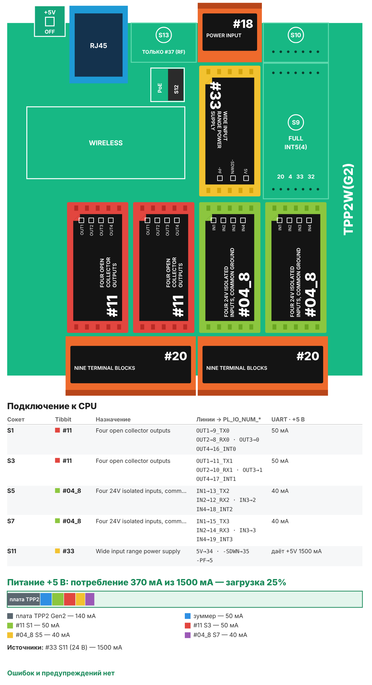

# Рецепт 16. Подбор по свету с ТСД

Работник сканирует код товара терминалом сбора данных (ТСД), у нужной ячейки стеллажа загорается лампа. Он берёт товар, нажимает кнопку у ячейки - лампа гаснет, строка задания собрана. Подходит для сборки заказов и для раскладки товара по заказам («положи в ячейку»): ошибок меньше, новичка учить почти не нужно.

ТСД работает через обычный браузер: никакого приложения на терминал ставить не нужно. Подойдёт CipherLab, Point Mobile или любой Android-терминал со сканером.

| | |
|---|---|
| Плата | Tibbo TPP2(G2) в корпусе TPB2 |
| Ячейки | 8 на контроллер: лампа 24 В (Tibbit #11) и кнопка (Tibbit #04-8) у каждой |
| ТСД | любой с браузером и сканером в режиме клавиатуры; страница `http://<IP>/` |
| Задание | из учётной системы запросами `add.html` или вручную на странице `task.html`, до 48 строк |
| Питание | 24 В DC (Tibbit #33) |
| Прошивка | Tibbo BASIC, TIDE, библиотеки 2_01_05 |
| Проверка | Собирается компилятором Tibbo без ошибок и предупреждений (ноябрь 2026). Логика ячеек и кнопок проверена на модели по сценариям. На устройстве и ТСД не проверялось |
| Лицензия | MIT |

## Что в архиве

| Файл | Что это |
|---|---|
| `tide/` | Проект TIDE. Настройки - в `config.tbh` |
| `bom.csv` | Спецификация со ссылками на каталог tibbo.ru |
| `board.svg`, `board.png` | Раскладка Tibbit по сокетам и бюджет питания |

## Комплект

| Кол-во | Позиция | Где |
|---|---|---|
| 1 | Плата TPP2(G2), Tibbo Project PCB Size 2 Gen 2 | - |
| 1 | Корпус TPB2 для TPP2 | - |
| 2 | Tibbit #11: четыре выхода с открытым коллектором, 24 В, 0,5 А | S1 (лампы 1-4), S3 (лампы 5-8) |
| 2 | Tibbit #04-8: четыре оптовхода 24 В, общая земля | S5 (кнопки 1-4), S7 (кнопки 5-8) |
| 2 | Tibbit #20: колодка на 9 клемм | S2+S4, S6+S8 |
| 1 | Tibbit #33: источник питания 5 В от 8-60 В | S11 |
| 1 | Tibbit #18: разъём питания и 2 клеммы | S12 |
| 1 | Блок питания 24 В DC на DIN-рейку, от 1 А | не входит в каталог Tibbo |
| 8 | Светодиодная лампа или индикатор 24 В DC, до 0,5 А | не входит в каталог Tibbo |
| 8 | Кнопка без фиксации, нормально разомкнутая | не входит в каталог Tibbo |
| 1+ | ТСД с Android и сканером штрихкодов: CipherLab, Point Mobile и другие | у поставщика ТСД |
| 1 | Точка доступа Wi-Fi в той же сети, что и контроллер | не входит в каталог Tibbo |

Позиции Tibbo - около $520 по розничным ценам каталога. Потребление по линии +5 В - 370 мА при запасе источника 1 500 мА (загрузка 25%).

**Почему так.**

- **Лампы - через #11 без реле.** Выход включает нагрузку 24 В до 0,5 А, а светодиодной лампе нужно 20-50 мА. Реле здесь лишние: щёлкают, изнашиваются и занимают место.
- **Кнопки - на оптовходы 24 В (#04-8), а не на «сухие» входы.** Провода к кнопкам идут вдоль всего стеллажа, рядом погрузчики и зарядки. Сигнал 24 В через оптрон помехи сбивают хуже, чем сигнал 5 В.
- **Источник #33.** Выдерживает провалы и выбросы питания, а 24 В - обычное питание для шкафов и стеллажной автоматики.

**Вариант «эконом».** Блок питания 12 В, источник #10 с разъёмом #18, лампы 12 В, кнопки - на входы «сухой контакт» #54 вместо #04-8 (в тех же сокетах). Кнопка замыкает вход на общий провод, отдельные 24 В к кнопкам не нужны. Прошивку менять не нужно: у #54 нажатая кнопка тоже даёт низкий уровень. Чем платите: сигнал кнопки слабее, и на длинных проводах помехи сбивают его легче. Для короткого стеллажа на 1-2 метра - разумно.

**Для расширения.** Сокет S9 свободен. В него можно поставить третий #11, чтобы зажигать над стеллажом лампу «задание собрано», или #05 (RS-485) для дисплеев с количеством.

## Как это работает

1. Учётная система загружает задание: строки «код товара - ячейка - количество - название».
2. Работник открывает на ТСД страницу контроллера и сканирует товар.
3. Контроллер находит строку и зажигает лампу ячейки. На экране ТСД крупно: номер ячейки, сколько взять, название.
4. Работник берёт товар и нажимает кнопку у ячейки. Лампа гаснет, на ТСД - «Собрано ✓», строка отмечена.

Особые случаи:
- **Кода нет в задании** - на ТСД «Нет в задании», лампы не загораются, событие в журнале.
- **Ячейка ещё горит** от прошлого скана - на ТСД «Ячейка занята»: сначала нажмите её кнопку.
- **Строка уже собрана** - на ТСД «Уже собрано».
- **Кнопка ячейки без задания** - лампа этой ячейки трижды мигает, событие в журнале.

Ламп может гореть несколько одновременно: например, двое работников собирают разные заказы с одного стеллажа.

## Сборка

1. Вставьте Tibbit в сокеты по таблице. Ключ на корпусе Tibbit совпадает с ключом сокета.
2. Лампы: +24 В блока питания → лампа → выход #11 (клеммы #20). Выход замыкает лампу на общий провод. Лампы 1-4 - на #11 в S1, 5-8 - на #11 в S3.
3. Кнопки: +24 В → кнопка → вход «+» #04-8 (клеммы #20). Вход «-» соединён с общим проводом внутри модуля. Кнопки 1-4 - на #04-8 в S5, 5-8 - в S7.
4. Подайте 24 В на разъём #18 в S12 (на клеммы или на джек, не одновременно), подключите Ethernet.
5. Откройте `http://<IP>/task.html` и нажмите «Проверить лампы»: все восемь мигают 2 секунды. Нажмите каждую кнопку - на #04-8 загорается зелёный светодиод входа.

Номера клемм покажет AppBlocks (панель Device → Wiring) или страницы [Tibbit #11](https://tibbo.ru/kb/docs/tibbit_11.html) и [Tibbit #04-8](https://tibbo.ru/kb/docs/tibbit_04-8.html). Напряжение на выходах #11 - не выше 24 В.

## Настройка ТСД

Сканер должен работать в режиме клавиатуры и добавлять Enter после кода. Тогда код попадает в поле страницы и отправляется сам.

**CipherLab** (RS35, RS36, RK25 и другие на Android): приложение ReaderConfig → профиль по умолчанию → Data Output → Keyboard Emulation = KeyEvent; Auto Enter = «Decoded data + Enter char».

**Point Mobile** (PM45, PM75, PM85 и другие): Настройки → ScanSettings → Basic → Wedge mode, вывод как нажатия клавиш, суффикс Enter. Отдельный профиль для браузера настраивается в Wedge Profiler.

Названия пунктов зависят от модели и версии прошивки терминала. Проверка: откройте любой текстовый редактор и отсканируйте код - он должен напечататься и перевести строку.

Дальше:
1. Подключите ТСД к Wi-Fi в той же сети, что и контроллер.
2. Откройте в браузере `http://<IP>/` и добавьте страницу на главный экран.
3. Поле ввода не вызывает экранную клавиатуру (`inputmode=none`), сканер всё равно пишет в него. Если поле потеряло фокус - коснитесь экрана.

## Задание из учётной системы

| Что | Запрос |
|---|---|
| Добавить строку | `GET http://<IP>/add.html?c=4607001234567&n=3&q=2&t=Перчатки` → `OK`, `FULL` (задание заполнено) или `ERR` |
| Очистить задание | `GET http://<IP>/cmd.html?a=clear` |
| Что собрано | `http://<IP>/task.csv` → `код;ячейка;кол-во;название;состояние` (0 ждёт, 1 горит, 2 собрано) |
| Журнал | `http://<IP>/log.csv` → `время;ячейка;код;событие`, последние 24 события |
| Состояние | `http://<IP>/state.txt` → `лампы;собрано;строк;номер события;событие;время` |

Название передаётся в UTF-8 с кодированием URL, до 32 байт. Задание хранится в оперативной памяти: после выключения питания его нужно загрузить снова. Так EEPROM не изнашивается от постоянной перезаписи заданий.

## Загрузка прошивки

1. Установите [TIDE](https://tibbo.ru/downloads) и откройте `tide/pick_to_light.tpr`.
2. Поправьте `config.tbh` (сеть, имя стеллажа, часовой пояс), нажмите F7 (сборка).
3. Выберите контроллер в Device Explorer и нажмите F5. Для работы на складе переключите сборку в Release и загрузите ещё раз.

## Частые проблемы

| Симптом | Что проверить |
|---|---|
| Скан не отправляется | Сканер не добавляет Enter - включите суффикс Enter в настройках ТСД |
| Код приходит с лишними символами | В профиле сканера выключите префиксы и символ AIM; код в задании должен совпадать посимвольно |
| Лампа не горит | «Проверить лампы» на `task.html`; красный светодиод выхода на #11 горит, а лампа нет - проводка или лампа |
| Кнопка не срабатывает | Зелёный светодиод входа на #04-8 при нажатии; нет - проводка или 24 В на кнопке |
| На ТСД «Нет связи с контроллером» | ТСД и контроллер в одной сети; Wi-Fi на краю зоны покрытия |

## Вариант для AppBlocks

Варианта для AppBlocks пока нет: страница для ТСД с таблицей задания удобнее в коде. Лампы и кнопки в AppBlocks собираются блоками GPIO, задание - таблицей Data Tables.

## Доработка с Claude

Со [скиллами Tibbo для Claude](https://tibbo.ru/skills.html) проект можно менять словами:

- «Добавь в рецепт 16 лампу "задание собрано" на третьем #11 в S9»
- «Сделай 16 ячеек на одном контроллере на TPP3(G2)»
- «Отправляй каждое подтверждение в MQTT для учётной системы»

## История версий

| Версия | Что изменилось |
|---|---|
| 1.0.0 | Первая версия |
