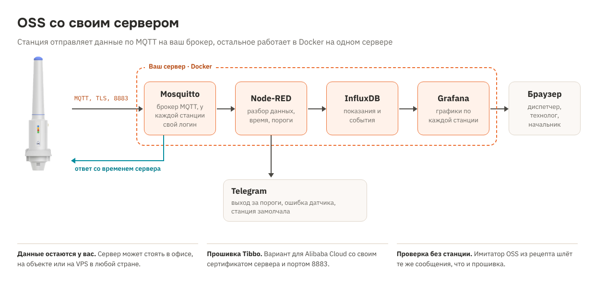

# Рецепт 17. OSS со своим сервером: MQTT вместо Azure

Станция Tibbo OSS отправляет данные не только в Azure. Этот рецепт показывает, как принимать их на своём сервере: свой брокер MQTT, графики в Grafana, оповещения в Telegram. Данные остаются у вас, подписка на облако не нужна, сервер может стоять в любой стране или прямо на объекте.

Что такое OSS, какие бывают модели и как её настроить с телефона - в разделе [tibbo.ru/oss](https://tibbo.ru/oss/) и в [руководстве по настройке](https://tibbo.ru/oss/guide.html).

| | |
|---|---|
| Устройство | Tibbo OSS (Outdoor Sensor System), любая модель: Wi-Fi или LTE, батарея или внешнее питание |
| Прошивка OSS | Вариант Tibbo для Alibaba Cloud из [tibbotech/OSS_Apps](https://github.com/tibbotech/OSS_Apps) со своим сертификатом сервера |
| Сервер | Docker: Mosquitto, Node-RED, InfluxDB 2, Grafana. Подойдёт VPS на 1 ядро и 2 ГБ памяти |
| Связь | MQTT по TLS 1.2, порт 8883, у каждой OSS свой логин и доступ только к своим топикам |
| Проверка | Сервер проверен имитатором OSS: время, данные, события, пороги, «нет данных», права и пароли. Изменённая прошивка собирается компилятором Tibbo без ошибок, а упаковщик `.tcu` даёт файлы, совпадающие байт в байт с официальными прошивками Tibbo. На живой OSS не проверялось |
| Лицензия | MIT для файлов рецепта. Исходники прошивки - Tibbo, скачиваются из их репозитория |

## Зачем это нужно

- **Независимость.** Данные хранятся на вашем сервере, а не у облачного провайдера. Если доступ к облаку ограничен, работа не останавливается.
- **Нет абонентской платы за облако.** Хватает недорогого VPS или сервера в офисе.
- **Свои правила.** Пороги, оповещения и отчёты настраиваются под задачу, данные легко передать в 1С, SCADA или любую другую систему через MQTT или InfluxDB.

## Как это устроено



1. OSS подключается к брокеру по TLS со своим логином и паролем.
2. При подключении OSS спрашивает время. Node-RED отвечает часами сервера: так у данных правильные метки времени.
3. OSS отправляет данные в формате Alibaba Cloud (Alink JSON). Node-RED разбирает их и пишет в InfluxDB.
4. Grafana показывает графики по каждой станции: температура, влажность, CO2, заряд батареи, события.
5. Node-RED сообщает в Telegram о выходе за пороги, ошибках датчика и о том, что станция замолчала.

## Почему прошивка для Alibaba Cloud

Tibbo выпускает прошивку OSS в двух вариантах. Вариант для Azure подключается через сервис регистрации устройств Azure. Вариант для Alibaba Cloud работает по обычному MQTT, а адрес сервера, логин и пароль берёт из настроек устройства - их видно в приложении OSS Companion. Поэтому его можно направить на любой брокер MQTT.

Что нужно поменять, чтобы OSS подключалась к вашему брокеру:

| Что | В прошивке Tibbo | Для своего сервера |
|---|---|---|
| Корневой сертификат | GlobalSign Root CA (Alibaba) | Ваш `ca.cer` - OSS проверяет сертификат сервера |
| Порт | 1883 с TLS | 8883 с TLS (можно оставить 1883) |
| Версия | `ALI1.00.00` | `OWN1.00.00` - чтобы в приложении было видно вашу сборку |

Остальное прошивка делает сама. Сервер должен отвечать на запрос времени - это делает поток Node-RED из рецепта.

Tibbo и сама делает такие сборки: в репозитории есть прошивка `OSS_Docker_FW` для собственного сервера, а в проекте для Azure предусмотрена замена сертификата на свой `ca.cer`.

## Что в архиве

| Папка | Что это |
|---|---|
| `server/` | Сервер: `docker-compose.yml`, настройки Mosquitto, поток Node-RED, панель Grafana, скрипты |
| `firmware/oss_patch.py` | Правит скачанные исходники Tibbo: сертификат, порт, версия |
| `firmware/tcu_pack.py` | Собирает файл `.tcu` для загрузки в OSS через приложение. Повторяет формат скрипта Tibbo `tcu-pack.ps1` |
| `tools/oss_sim.py` | Имитатор OSS: проверить сервер до того, как перешивать станцию |
| `bom.csv` | Спецификация |
| `scheme.png` | Схема решения |

## Шаг 1. Сервер

Нужен компьютер или VPS с Docker и постоянным адресом: доменное имя или белый IP.

```
cd server
cp .env.example .env              # замените все change-me, токен: openssl rand -hex 32
./scripts/make-certs.sh mqtt.example.ru     # или IP-адрес сервера
docker compose up -d
./scripts/add-device.sh wh01 oss1           # логин, пароль и права для первой OSS
```

`add-device.sh` выводит четыре значения для OSS Companion: адрес сервера, логин вида `wh01&oss1`, Client ID и пароль. Логин не длиннее 16 знаков - это ограничение прошивки.

Откройте на сервере порт 8883 для OSS и порт 3000 для Grafana. Редактор Node-RED открыт только на самом сервере: `ssh -L 1880:127.0.0.1:1880 сервер`, затем http://127.0.0.1:1880.

Проверьте сервер имитатором, станция для этого не нужна:

```
pip install paho-mqtt
python3 tools/oss_sim.py --host mqtt.example.ru --ca server/certs/ca.crt \
  --user 'wh01&oss1' --client wh01 --password <пароль> --hot
```

Имитатор должен получить время от сервера. В Grafana появятся данные, в Telegram - тревога по температуре и CO2 и тестовая ошибка датчика.

## Шаг 2. Прошивка OSS

Нужен Windows с [TIDE](https://tibbo.ru/downloads) и Python 3.

1. Скачайте репозиторий Tibbo: https://github.com/tibbotech/OSS_Apps (кнопка Code → Download ZIP).
2. Подготовьте исходники:
   ```
   python firmware/oss_patch.py OSS_Apps/OSS_Alicloud/OSS_Ali_APP1 server/certs/ca.cer 8883 OWN1.00.00
   ```
3. Откройте `OSS_Ali_APP1.tpr` в TIDE и соберите проект (F7). Получится `OSS_Ali_APP1.tpc`.
4. Соберите файл для загрузки. APP0 и TiOS - те же, что в официальной прошивке Tibbo 1.01.00 (команда для Windows; в Linux вместо `^` ставьте `\`):
   ```
   python firmware/tcu_pack.py OSS_Apps/OSS_Alicloud/OSS_Ali_APP1/Platforms/WM2000/firmware/tios-wm2000-4_03_07.bin ^
     OSS_Apps/OSS_Alicloud/Release_Files/1_01_00/OSS_Ali_APP0.tpc ^
     OSS_Apps/OSS_Alicloud/OSS_Ali_APP1/OSS_Ali_APP1.tpc OSS_OWN_FW.tcu
   ```
5. Загрузите `OSS_OWN_FW.tcu` в OSS: OSS Companion → Update Firmware → Select a File → поднесите телефон к значку NFC. Файл передаётся по Bluetooth.

Сначала проверьте упаковщик на официальной прошивке: из файлов Tibbo 1.01.00 он должен собрать `OSS_Ali_FW_1-00-00.tcu` байт в байт.

## Шаг 3. Настройка OSS

В OSS Companion: Configure → поднесите телефон к значку NFC.

| Поле | Значение |
|---|---|
| Communication Mode | Wi-Fi, Cellular или Wi-Fi with Cellular Backup |
| Wi-Fi SSID и пароль, APN | Ваша сеть и SIM-карта |
| Server URL | Имя или IP сервера - ровно как в `make-certs.sh` |
| Username | `wh01&oss1` из `add-device.sh` |
| Client ID | `wh01` |
| Primary Key | Пароль из `add-device.sh` |
| Operation Mode | Low-Power - для батареи, Always On - при внешнем питании |
| Sensor Type, Modbus Device ID | Встроенный модуль или датчик Modbus |
| Sensor Sampling Time | Как часто мерить, минуты |
| No. of Samples to Aggregate | Сколько замеров копить до отправки - чем больше, тем дольше живёт батарея |

Сохраните и перезагрузите OSS. По документации Tibbo зелёный светодиод мигает, пока станция подключается к облаку, и горит постоянно, когда подключена. В варианте для Alibaba светодиоды могут вести себя иначе - надёжнее смотреть, пришли ли данные в Grafana.

## Оповещения

Пороги задаются в `.env`, строкой JSON:

```
THRESHOLDS={"temperature":{"max":30,"hyst":1},"co2":{"max":1500,"hyst":100},"BAT_LVL":{"min":20,"hyst":5}}
```

- `max` и `min` - границы, `hyst` - на сколько значение должно вернуться, чтобы тревога снялась. Так одно колебание у границы не даёт десяток сообщений.
- `NODATA_MIN` - через сколько минут без данных прислать «нет данных». Ставьте больше, чем `Sensor Sampling Time × No. of Samples to Aggregate`.
- Ошибки датчика из событий OSS («Unable to read sensor parameters» и подобные) приходят сразу.

Имена величин - как их шлёт прошивка: `temperature`, `humidity`, `co2`, `BAT_LVL`; у датчиков Modbus - например `SoilHumd`, `SoilTemp`, `pH`, `H2S`, `PM2.5`, `Flood`.

## Безопасность

- Каждая OSS видит только свои топики: это задаёт `add-device.sh` в `mosquitto/config/acl`.
- Порт 1883 без пароля открыт только внутри сети docker, для Node-RED. Наружу - только 8883 с TLS.
- `certs/ca.key` храните отдельно от сервера: им подписываются сертификаты, которым доверяют все ваши OSS.
- Сертификат сервера выпускается на 5 лет. Новый подписывайте тем же `ca.key` (`make-certs.sh` не создаёт новый центр, если он уже есть) - тогда перешивать OSS не нужно.
- `.env`, `certs/`, `passwd` в git не кладите.

## Ограничения и что проверить

- Прошивка со своим сертификатом подключается только к вашему серверу. Чтобы вернуть OSS в Azure или облако Tibbo, загрузите официальную прошивку из репозитория Tibbo.
- Обновлять такую прошивку удобнее на месте, через приложение. Обновление по воздуху качает файл по HTTPS с сертификатом GlobalSign, срок которого истекает в январе 2028 года.
- Удалённое изменение настроек через сервер в рецепт не входит. Прошивка поддерживает его через топик `shadow`, но мы это не проверяли.
- Время с сервера приходит в UTC, часовой пояс станции задаётся полем Time Zone.
- Перед объектом проверьте на одной станции: подключение по TLS к вашему сертификату, ответ на запрос времени, расход батареи при вашем периоде опроса.

## Частые проблемы

| Симптом | Что проверить |
|---|---|
| Зелёный светодиод мигает и не загорается | Server URL совпадает с именем в сертификате; порт 8883 открыт; в прошивке ваш `ca.cer` |
| Брокер пишет «not authorised» | Логин `устройство&продукт`, пароль и Client ID из `add-device.sh`; `docker compose kill -s HUP mosquitto` после добавления |
| Данные есть, но время 1970 или 2000 год | Поток Node-RED не отвечает на запрос времени - смотрите узел «ответ со временем» |
| В Grafana пусто | Токен InfluxDB в `.env` одинаковый для всех сервисов; в Node-RED нет предупреждений «InfluxDB ответил» |
| Нет сообщений в Telegram | Токен бота и номер чата; бот добавлен в чат и ему написали хотя бы раз |

## История версий

| Версия | Что изменилось |
|---|---|
| 1.0.0 | Первая версия |
