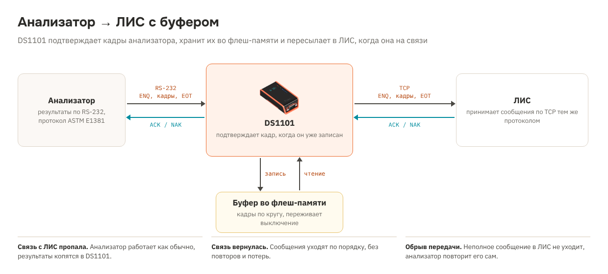

# Рецепт 18. Анализатор → ЛИС с буфером: результаты не теряются, когда ЛИС недоступна

Лабораторный анализатор передаёт результаты в лабораторную информационную систему (ЛИС) по RS-232. Обычно между ними стоит кабель или конвертер, который прозрачно передаёт байты. Если ЛИС перезагружается, сеть падает или сервер обновляют, анализатор не может сдать результаты: одни модели останавливаются и ждут, другие выдают ошибку, и лаборант переносит результаты вручную.

DS1101 из этого рецепта сам принимает результаты у анализатора по протоколу ASTM, сразу записывает каждый кадр во флеш-память и только потом подтверждает его. В ЛИС сообщения уходят тем же протоколом по сети. Нет связи с ЛИС - результаты копятся в DS1101 и уходят по порядку, когда связь вернётся. Анализатор при этом работает как обычно.

| | |
|---|---|
| Контроллер | Tibbo DS1101 (готовое устройство в корпусе) |
| Анализатор | RS-232 на DB9, протокол ASTM E1381 / CLSI LIS01 (ENQ, кадры STX ... ETX, ACK, EOT) |
| ЛИС | TCP-клиент: DS1101 подключается к IP и порту ЛИС и передаёт сообщения тем же протоколом ASTM |
| Буфер | Флеш-память DS1101, по умолчанию 1024 сектора: примерно 150 результатов по 5 записей ASTM, больше - если флеш-памяти хватает. Переживает выключение питания |
| Сеть | HTTP 80 - страница состояния и `state.txt` для мониторинга |
| Прошивка | Tibbo BASIC, TIDE, платформа DS1101N, библиотеки 2_01_05 |
| Проверка | Собирается компилятором Tibbo без ошибок и предупреждений. Логика приёма, буфера и отправки проверена на модели (Python): обычная работа, 5 сообщений при недоступной ЛИС, длинная запись в нескольких кадрах, отказ ЛИС (NAK), испорченный кадр, перезагрузка посреди передачи, буфер по кругу несколько раз, полный буфер. С настоящим анализатором и ЛИС не проверялось |
| Лицензия | MIT |

## Что в архиве

| Файл | Что это |
|---|---|
| `tide/` | Проект TIDE. Настройки - в `config.tbh` |
| `bom.csv` | Спецификация |
| `scheme.png` | Схема решения |

## Комплект

| Кол-во | Позиция | Где |
|---|---|---|
| 1 | Программируемый сервер устройств DS1101 (RS-232, Ethernet) | [каталог](https://tibbo.ru/products/ds1101) |
| 1 | Блок питания 12 В DC от 0,5 А (или DS1101 с PoE) | не входит в каталог Tibbo |
| 1 | Кабель RS-232 DB9 под разъём анализатора (прямой или нуль-модемный - по документации анализатора) | не входит в каталог Tibbo |

**Почему DS1101, а не DS1100.** Для буфера нужна флеш-память, доступная программе: у DS1101 она есть, у DS1100 нет. Если буфер не нужен и достаточно прозрачной передачи, хватит DS1100 с готовой прошивкой Serial-over-IP - см. [решение «Медицинское оборудование в сеть»](https://tibbo.ru/solutions/medical-devices).

## Как это работает

1. Анализатор отправляет ENQ. Если в буфере есть место, DS1101 отвечает ACK.
2. Каждый кадр DS1101 проверяет: номер кадра и контрольную сумму. Кадр правильный - он записывается во флеш-память и только потом анализатор получает ACK. Ошибка - NAK, анализатор повторит кадр.
3. EOT от анализатора - передача целая, она становится в очередь в ЛИС.
4. DS1101 подключается к ЛИС, отправляет ENQ и после ACK - кадры по одному, с новой нумерацией и контрольной суммой. NAK от ЛИС - повтор кадра до 6 раз, нет ответа 15 с - EOT и новая попытка через 10 с.
5. ЛИС приняла сообщение целиком - DS1101 записывает отметку «принято» и берётся за следующее.

**Порядок сохраняется:** сообщения уходят в ЛИС в том порядке, в каком пришли от анализатора.

**Обрыв передачи.** Если анализатор не прислал EOT (кабель выдернули, анализатор перезагрузился, пауза больше 30 с) или DS1101 выключили посреди передачи, неполное сообщение в ЛИС не уходит. Анализатор не получил подтверждения конца передачи и, как требует протокол, повторит её.

**Буфер полон.** Если ЛИС недоступна долго и свободных кадров меньше `CFG_MIN_FREE`, DS1101 отвечает анализатору NAK на ENQ - так же, как занятая ЛИС. Анализатор повторит позже, данные не теряются.

**Износ флеш-памяти.** Каждый кадр - новый сектор по кругу, служебных таблиц, которые переписываются при каждой записи, нет. Износ распределяется по всему буферу: при 1024 секторах и тысяче кадров в сутки каждый сектор перезаписывается примерно раз в сутки, а флеш-память рассчитана примерно на 100 000 циклов.

## Подключение

1. Соедините DB9 анализатора и DS1101 кабелем RS-232. Тип кабеля (прямой или нуль-модемный) - в документации анализатора, раздел про интерфейс ЛИС.
2. Подайте питание 12 В, подключите Ethernet.
3. В настройках анализатора включите передачу результатов в ЛИС по RS-232 с протоколом ASTM (часто называется «LIS2-A2», «ASTM E1394» или «Host»). Скорость и формат порта - те же, что в `config.tbh`.
4. В ЛИС заведите подключение анализатора по TCP в режиме «сервер»: ЛИС слушает порт, DS1101 подключается к нему.

## Настройка

В `config.tbh`:

- `CFG_LIS_IP`, `CFG_LIS_PORT` - адрес ЛИС и порт для этого анализатора;
- `CFG_BAUD`, `CFG_PARITY`, `CFG_BITS` - формат порта анализатора;
- `CFG_LOG_SECTORS` - размер буфера в кадрах, `CFG_MIN_FREE` - запас, при котором новые передачи не принимаются;
- сеть: DHCP или статический адрес.

## Как пользоваться

| Что | Где |
|---|---|
| Состояние | `http://<IP>/`: сколько сообщений ждут отправки, связь с ЛИС, свободное место, счётчики |
| Мониторинг | `http://<IP>/state.txt` - строки `ключ=значение`: `lis_connected`, `queue_messages`, `buffer_free`, `naks_to_analyzer` и другие. Удобно для Zabbix: тревога, если `queue_messages` растёт или `lis_connected=0` дольше 10 минут |

## Чего рецепт не делает

- **Задания из ЛИС на анализатор** (двунаправленный режим, запрос заданий по штрихкоду пробирки) не передаются: DS1101 только отправляет результаты. Если анализатору нужны задания, используйте прозрачный Serial-over-IP или доработайте рецепт.
- **HL7** не поддерживается, только ASTM E1381. Анализаторы, которые передают HL7 по RS-232 в обёртке MLLP, требуют другого разбора.
- **ЛИС без протокола нижнего уровня.** Некоторые ЛИС по TCP принимают записи ASTM без ENQ, ACK и кадров. Для них отправку нужно переделать (процедура `lis_send_next` в `lis.tbs`).
- Содержимое сообщений DS1101 не разбирает и не меняет.

## Медицинское оборудование: что важно

- DS1101 передаёт только данные и не влияет на работу анализатора и результаты измерений. Медицинским изделием он не является.
- Ставьте DS1101 и его блок питания вне зоны пациента. Если анализатор стоит рядом с пациентом, между ним и DS1101 нужен изолятор RS-232 для медицинского оборудования.
- В сообщениях ASTM есть идентификаторы пациентов и результаты анализов. Буфер во флеш-памяти не шифруется, страница состояния открывается без пароля (она показывает только счётчики). Держите DS1101 в закрытом помещении и в отдельной сети или VLAN лабораторных приборов, доступ к ЛИС - только с IP-адреса DS1101.

## Загрузка прошивки

1. Установите [TIDE](https://tibbo.ru/downloads) и откройте `tide/lab_lis.tpr`.
2. Платформа проекта - DS1101N. Если у вашего DS1101 прошивка TiOS для DS1101W, смените платформу в настройках проекта: код тот же. В настройках проекта включён объект флеш-памяти (`OBJECT_FD`), он нужен для буфера.
3. Поправьте `config.tbh`, нажмите F7 (сборка).
4. Выберите контроллер в Device Explorer и нажмите F5. Для работы в лаборатории переключите сборку в Release и загрузите ещё раз.

## Что проверить на стенде

Рецепт написан по протоколу ASTM E1381 и документации Tibbo. До подключения к рабочей ЛИС:

- соедините DS1101 с тестовым экземпляром ЛИС или с программой-имитатором ЛИС и прогоните несколько десятков результатов с анализатора или его имитатора;
- выключите ЛИС, накопите результаты, включите - проверьте, что всё пришло, в правильном порядке и без повторов;
- выключите DS1101 посреди передачи и убедитесь, что анализатор повторил её, а в ЛИС не попала половина сообщения;
- проверьте таймауты вашего анализатора: если он ждёт ACK меньше, чем пишется кадр во флеш-память (обычно миллисекунды), это будет видно сразу.

## Частые проблемы

| Симптом | Что проверить |
|---|---|
| Анализатор пишет «ошибка связи с ЛИС» | Скорость и формат порта; тип кабеля; в анализаторе включён протокол ASTM, а не «без протокола» |
| Очередь растёт, ЛИС «на связи» | ЛИС отвечает NAK или не отвечает на ENQ: протокол нижнего уровня в настройках ЛИС; ошибка видна на странице |
| «нет соединения с ЛИС» | IP и порт ЛИС; ЛИС слушает порт; сетевой фильтр между DS1101 и сервером |
| Много NAK анализатору | Помехи на кабеле или неверный формат порта; буфер полон, если ЛИС долго недоступна |

## Вариант для AppBlocks

Варианта для AppBlocks нет: протокол ASTM с подтверждениями и буфер во флеш-памяти удобнее писать кодом.

## Доработка с Claude

Со [скиллами Tibbo для Claude](https://tibbo.ru/skills.html) проект можно менять словами:

- «Добавь в рецепт 18 передачу заданий из ЛИС на анализатор»
- «Отправляй результаты в ЛИС как записи без кадров ASTM»
- «Подключи к DS1101 второй анализатор на порт 1 со своим буфером»

## История версий

| Версия | Что изменилось |
|---|---|
| 1.0.0 | Первая версия |
