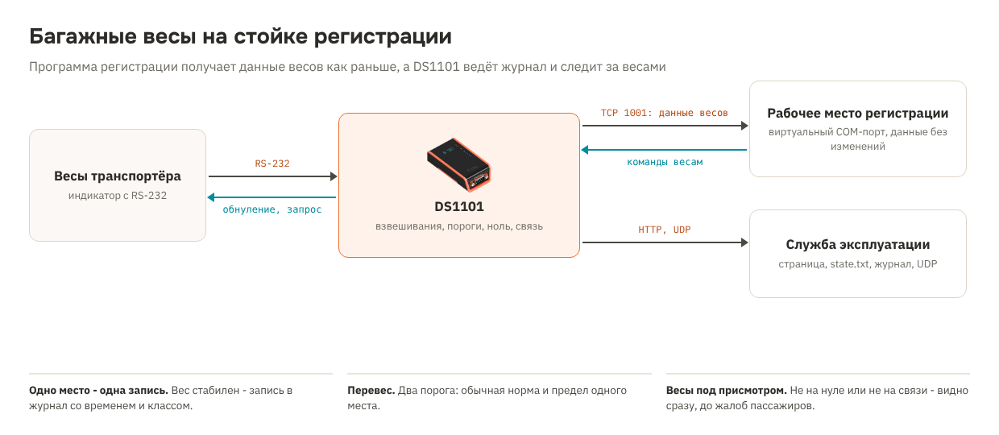

# Рецепт 19. Багажные весы на стойке регистрации: журнал взвешиваний, перевес и контроль весов

На стойке регистрации весы ленточного транспортёра передают вес в программу регистрации по RS-232. Рецепт выводит весы в сеть и не мешает этой связи: программа регистрации получает данные весов через виртуальный COM-порт точно такими же, как по кабелю. Параллельно DS1101 сам видит каждое взвешивание и ведёт журнал, отмечает перевес по двум порогам, следит, чтобы пустые весы показывали ноль и были на связи, и отдаёт всё это по сети службе эксплуатации.

| | |
|---|---|
| Контроллер | Tibbo DS1101 (готовое устройство в корпусе) |
| Весы | RS-232 на DB9, вес в килограммах, непрерывная передача или «по запросу» |
| Сеть | TCP 1001 - прозрачный канал для программы регистрации (виртуальный COM-порт), HTTP 80 - страница, `state.txt`, `weighings.csv`, UDP - сообщение о каждом взвешивании |
| Время | SNTP, часы DS1101 |
| Прошивка | Tibbo BASIC, TIDE, платформа DS1101N, библиотеки 2_01_05 |
| Проверка | Собирается компилятором Tibbo без ошибок и предупреждений. Разбор строки весов - как в рецептах 06 и 15. С настоящими весами и программой регистрации не проверялось |
| Лицензия | MIT |

## Что в архиве

| Файл | Что это |
|---|---|
| `tide/` | Проект TIDE. Настройки - в `config.tbh` |
| `bom.csv` | Спецификация |
| `scheme.png` | Схема решения |

## Комплект

| Кол-во | Позиция | Где |
|---|---|---|
| 1 | Программируемый сервер устройств DS1101 (RS-232, Ethernet) | [каталог](https://tibbo.ru/products/ds1101) |
| 1 | Блок питания 12 В DC от 0,5 А (или DS1101 с PoE) | не входит в каталог Tibbo |
| 1 | Кабель RS-232 DB9 под разъём индикатора весов | не входит в каталог Tibbo |

**Почему DS1101, а не DS1100 из рецепта 06.** Для журнала со временем нужны часы: у DS1101 они есть, у DS1100 нет. Если журнал не нужен, а нужен только вес в сети, хватит [рецепта 06](https://tibbo.ru/recipes/scale-ds1100) на DS1100.

## Как это работает

1. Весы передают строки с весом. DS1101 без изменений пересылает их в прозрачный канал TCP 1001, а команды программы регистрации (обнуление, запрос веса) - обратно на весы.
2. Из той же строки DS1101 берёт вес и признак стабильности.
3. Весы пустели (вес меньше 0,2 кг), затем на них положили багаж от 1 кг, вес стабилен около секунды - это одно взвешивание. Оно попадает в журнал со временем и классом: в норме, больше первого порога (23 кг), больше второго (32 кг). Пороги задаются в `config.tbh`.
4. Следующее взвешивание - после того, как багаж уехал с весов.
5. Пустые весы минуту показывают больше 0,1 кг - на странице и в `state.txt` появляется «весы не на нуле». Нет строк от весов 5 с - «весы не на связи».

## Важно: официальный вес

Вес, по которому начисляют плату за перевес, программа регистрации берёт у весов, как и раньше: DS1101 передаёт данные весов без изменений. Журнал и пороги рецепта - для службы эксплуатации и статистики, а не для расчётов с пассажиром. Поверка весов и их подключение к программе регистрации остаются как есть.

## Подключение

1. Соедините DB9 индикатора весов и DS1101 кабелем RS-232 (прямой или нуль-модемный - по документации весов).
2. Подайте питание 12 В или PoE, подключите Ethernet.
3. На рабочем месте регистрации установите Tibbo Device Server Toolkit и создайте виртуальный COM-порт на IP DS1101, TCP 1001. В программе регистрации укажите этот COM-порт вместо физического.

## Настройка

В `config.tbh`:

- `CFG_COUNTER` - номер стойки, попадает в журнал и сообщения;
- формат порта весов, `CFG_POLL_CMD` для весов «по запросу», `CFG_STABLE_MARK` - признак стабильного веса;
- `CFG_LIMIT1_G`, `CFG_LIMIT2_G` - пороги перевеса, граммы;
- `CFG_ZERO_WARN_G`, `CFG_ZERO_WARN_HALFSEC` - контроль нуля;
- `CFG_UDP_IP`, `CFG_UDP_PORT` - куда отправлять сообщение о каждом взвешивании: `A12;2026-11-14 09:05;23.4;1`;
- сервер времени и часовой пояс.

## Как пользоваться

| Что | Где |
|---|---|
| Вес и состояние | `http://<IP>/`: вес крупно с цветом по порогу, «весы на связи», «не на нуле», счётчики за сутки, последние 40 взвешиваний |
| Мониторинг | `http://<IP>/state.txt` - строки `ключ=значение`: `scale_online`, `zero_ok`, `weight_kg`, `bags_today`, `over_today` |
| Журнал | `http://<IP>/weighings.csv` - стойка;время;кг;класс |
| Сборщик | UDP на `CFG_UDP_IP:CFG_UDP_PORT` - одна строка на взвешивание, удобно для syslog или своего сервиса |

## Безопасность

Страница и файлы открываются без пароля и только читаются; изменить настройки по сети нельзя. Прозрачный канал TCP 1001 принимает одно подключение - ставьте DS1101 в сеть стоек регистрации и ограничьте доступ к порту 1001 рабочим местом этой стойки.

## Загрузка прошивки

1. Установите [TIDE](https://tibbo.ru/downloads) и откройте `tide/checkin_scale.tpr`.
2. Платформа проекта - DS1101N. Если у вашего DS1101 прошивка TiOS для DS1101W, смените платформу в настройках проекта: код тот же.
3. Поправьте `config.tbh`, нажмите F7 (сборка).
4. Выберите контроллер в Device Explorer и нажмите F5. Для работы на объекте переключите сборку в Release и загрузите ещё раз.

## Что проверить на стенде

- формат строки ваших весов: вес, единица «kg», признак стабильности;
- программа регистрации работает через виртуальный COM-порт так же, как через кабель: обнуление, запрос веса, таймауты;
- одно место багажа даёт ровно одну запись, в том числе когда лента сразу увозит багаж.

## Частые проблемы

| Симптом | Что проверить |
|---|---|
| «весы не на связи» | Скорость и формат порта; тип кабеля; `CFG_POLL_CMD` для весов «по запросу» |
| Вес есть, взвешиваний нет | Признак стабильности `CFG_STABLE_MARK`; багаж легче `CFG_MIN_G`; весы не опускались ниже `CFG_ZERO_G` |
| «весы не на нуле» без причины | Порог `CFG_ZERO_WARN_G` меньше шага индикатора; обнулите весы |
| Программа регистрации не видит весы | Виртуальный COM-порт на IP DS1101 и порт 1001; к порту уже подключилась другая программа |
| Время в журнале пустое | Нет доступа к серверу времени `CFG_NTP_SERVER` |

## Вариант для AppBlocks

Варианта для AppBlocks нет: прозрачный канал и разбор строки весов удобнее писать кодом.

## Доработка с Claude

Со [скиллами Tibbo для Claude](https://tibbo.ru/skills.html) проект можно менять словами:

- «Добавь в рецепт 19 отправку взвешиваний в MQTT»
- «Сделай пороги перевеса настраиваемыми со страницы с паролем»
- «Подключи к DS1101 вторые весы на порт 1»

## История версий

| Версия | Что изменилось |
|---|---|
| 1.0.0 | Первая версия |
