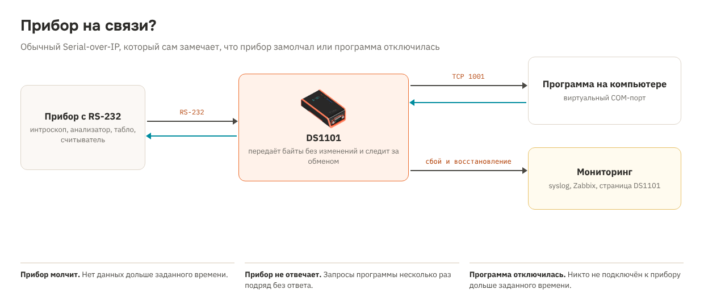

# Рецепт 20. Прибор на связи? Serial-over-IP с контролем обмена

Интроскоп на досмотре багажа, анализатор в лаборатории, табло, считыватель - прибор с RS-232 работает с программой на компьютере через конвертер в Ethernet. Когда связь пропадает, это часто замечают не сразу: прибор работает, программа молчит, а данные не идут. Ищут виноватого - кабель, конвертер, сеть, программу или сам прибор.

DS1101 в этом рецепте - обычный прозрачный Serial-over-IP: программа работает с прибором через виртуальный COM-порт, байты не меняются. Попутно DS1101 следит за обменом и сразу сообщает в syslog и на свою страницу, если:

- прибор ничего не передаёт дольше заданного времени;
- программа отправляет запросы, а прибор несколько раз подряд не отвечает;
- программа не подключена к прибору дольше заданного времени.

Так служба эксплуатации видит сбой раньше пользователей и сразу понимает, на чьей стороне проблема.

| | |
|---|---|
| Контроллер | Tibbo DS1101 (готовое устройство в корпусе) |
| Прибор | Любой с RS-232 на DB9: формат порта в `config.tbh` |
| Сеть | TCP 1001 - прозрачный канал для программы (виртуальный COM-порт), HTTP 80 - страница, `state.txt`, `events.csv`, UDP - syslog |
| Время | SNTP, часы DS1101 |
| Прошивка | Tibbo BASIC, TIDE, платформа DS1101N, библиотеки 2_01_05 |
| Проверка | Собирается компилятором Tibbo без ошибок и предупреждений. С настоящим прибором не проверялось |
| Лицензия | MIT |

## Что в архиве

| Файл | Что это |
|---|---|
| `tide/` | Проект TIDE. Настройки - в `config.tbh` |
| `bom.csv` | Спецификация |
| `scheme.png` | Схема решения |

## Комплект

| Кол-во | Позиция | Где |
|---|---|---|
| 1 | Программируемый сервер устройств DS1101 (RS-232, Ethernet) | [каталог](https://tibbo.ru/products/ds1101) |
| 1 | Блок питания 12 В DC от 0,5 А (или DS1101 с PoE) | не входит в каталог Tibbo |
| 1 | Кабель RS-232 DB9 под разъём прибора | не входит в каталог Tibbo |

**Почему DS1101, а не DS1100.** Для журнала событий со временем нужны часы: у DS1101 они есть, у DS1100 нет. Для прибора с RS-485 или RS-422 возьмите DS1102: код тот же, поменяйте платформу и режим порта.

## Как это работает

| Проверка | Как DS1101 её делает | Настройка |
|---|---|---|
| Прибор молчит | Нет ни одного байта от прибора дольше N минут. Для приборов, которые сами передают данные или статус | `CFG_SILENT_MIN` |
| Прибор не отвечает | Программа отправила запрос, ответ не пришёл за 2 с - промах. N промахов подряд - сбой | `CFG_REPLY_HALFSEC`, `CFG_REPLY_MISSES` |
| Программа не подключена | Никто не подключён к TCP 1001 дольше N минут | `CFG_PC_OFF_MIN` |

Сбой и восстановление - это события: они попадают в журнал на странице и в syslog. Проверка, которая не подходит вашему прибору, выключается значением 0.

**Содержимое обмена не сохраняется и не показывается** - только счётчики байтов. Для медицинских приборов это важно: через DS1101 могут идти данные пациентов.

## Подключение

1. Соедините DB9 прибора и DS1101 кабелем RS-232 (прямой или нуль-модемный - по документации прибора).
2. Подайте питание 12 В или PoE, подключите Ethernet.
3. На компьютере с программой установите Tibbo Device Server Toolkit и создайте виртуальный COM-порт на IP DS1101, TCP 1001. В программе укажите этот COM-порт.

## Настройка

В `config.tbh`:

- `CFG_NAME` - имя прибора в сообщениях, например `xray-03` или `analyzer-bio-1`;
- формат порта прибора;
- проверки и их пороги;
- `CFG_SYSLOG_IP`, `CFG_SYSLOG_PORT` - сервер syslog: rsyslog, Graylog, Zabbix с приёмом syslog;
- сервер времени и часовой пояс.

## Как пользоваться

| Что | Где |
|---|---|
| Состояние | `http://<IP>/`: «всё в порядке» или какой сбой, подключена ли программа, сколько прибор молчит, журнал событий |
| Мониторинг | `http://<IP>/state.txt` - строки `ключ=значение`: `device_silent`, `device_noreply`, `pc_off` (1 - сбой) и счётчики |
| Журнал | `http://<IP>/events.csv` - время;событие |
| syslog | Сообщение `<132>Nov 14 09:05:00 xray-03 tibbo: прибор не ответил 3 раз подряд`. Сбой - важность warning, восстановление - notice, источник local0 |

## Безопасность

Страница и файлы открываются без пароля и только читаются. Прозрачный канал TCP 1001 принимает одно подключение - ставьте DS1101 в отдельную сеть или VLAN приборов и ограничьте доступ к порту 1001 компьютером с программой.

## Загрузка прошивки

1. Установите [TIDE](https://tibbo.ru/downloads) и откройте `tide/link_monitor.tpr`.
2. Платформа проекта - DS1101N. Если у вашего DS1101 прошивка TiOS для DS1101W, смените платформу в настройках проекта: код тот же.
3. Поправьте `config.tbh`, нажмите F7 (сборка).
4. Выберите контроллер в Device Explorer и нажмите F5. Для работы на объекте переключите сборку в Release и загрузите ещё раз.

## Что проверить на стенде

- программа работает через виртуальный COM-порт так же, как через кабель;
- пороги: как часто прибор передаёт данные сам, сколько ему нужно на ответ. Если прибор отвечает не на каждую команду, выключите проверку ответов (`CFG_REPLY_MISSES 0`) или увеличьте число промахов;
- что сообщения доходят до вашего сервера syslog и правильно показывают русские буквы (UTF-8).

## Частые проблемы

| Симптом | Что проверить |
|---|---|
| «прибор молчит», хотя всё работает | Прибор передаёт данные только по запросу - выключите `CFG_SILENT_MIN` |
| «прибор не отвечает» на рабочем приборе | Прибор отвечает не на каждую команду или дольше 2 с - увеличьте `CFG_REPLY_HALFSEC` или `CFG_REPLY_MISSES` |
| Программа не видит прибор | Виртуальный COM-порт на IP DS1101 и порт 1001; к порту уже подключилась другая программа |
| Нет сообщений в syslog | `CFG_SYSLOG_IP`; сервер принимает UDP 514; сетевой фильтр |

## Вариант для AppBlocks

Варианта для AppBlocks нет: прозрачный канал с наблюдением за обменом удобнее писать кодом.

## Доработка с Claude

Со [скиллами Tibbo для Claude](https://tibbo.ru/skills.html) проект можно менять словами:

- «Добавь в рецепт 20 отправку событий в MQTT»
- «Следи за вторым прибором на порту 1 DS1101»
- «Перезагружай прибор через реле, если он не отвечает 10 минут»

## История версий

| Версия | Что изменилось |
|---|---|
| 1.0.0 | Первая версия |
