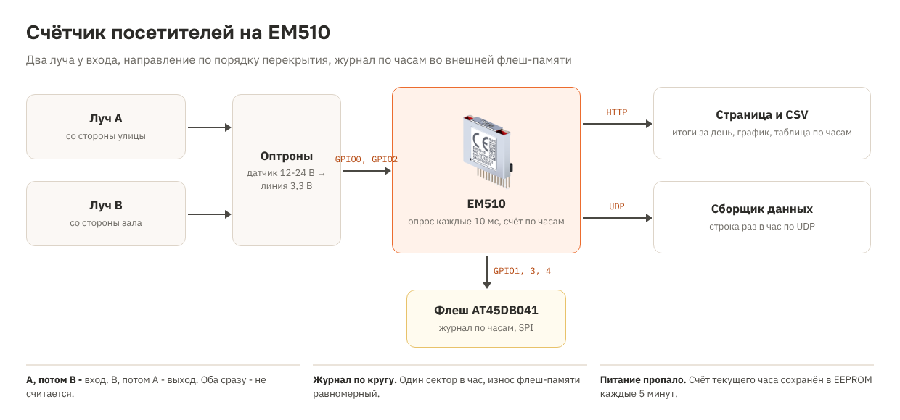

# Рецепт 21. Счётчик посетителей на модуле EM510: два луча, направление, журнал по часам

Счётчик для входа в магазин, музей, офис или учебный корпус. Два инфракрасных луча стоят у двери один за другим: какой луч человек перекрыл первым, в ту сторону он и шёл. Модуль EM510 считает входы и выходы по часам, хранит журнал по часам во внешней флеш-памяти - на несколько месяцев, показывает итоги на веб-странице и отдаёт их таблицей CSV.

Рецепт - для тех, кто делает свой счётчик на плате: EM510 размером 18,5 × 16 мм распаивается рядом с разъёмом RJ45. Для проверки подойдёт отладочная плата EM510EV.

| | |
|---|---|
| Модуль | Tibbo [EM510](https://tibbo.ru/products/em510) (Ethernet, 8 линий GPIO), платформа EM510W |
| Датчики | Два ИК-луча с выходом «сухой контакт» или открытый коллектор, через оптроны на GPIO0 и GPIO2 |
| Журнал | Внешняя флеш-микросхема AT45DB041 на GPIO1, GPIO3, GPIO4 по схеме Tibbo: 1 МБ для объекта fd. Одна запись - один час |
| Сеть | HTTP 80 - страница, `counts.csv`, `state.txt`; UDP - строка раз в час |
| Время | SNTP: у EM510 нет часов с батарейкой |
| Прошивка | Tibbo BASIC, TIDE, библиотеки 2_01_05 |
| Проверка | Собирается компилятором Tibbo без ошибок. Есть предупреждения о переопределении `WLN_AVAILABLE` - это намеренно: Wi-Fi в рецепте выключен. На плате и с датчиками не проверялось |
| Лицензия | MIT |

## Почему внешняя флеш-память

Внутреннюю флеш-память EM510 занимают TiOS и программа, флеш-диском её использовать нельзя. Для данных к EM510 подключают микросхему флеш-памяти по SPI (по схеме Tibbo - AT45DB041), тогда объект `fd` получает 1 МБ. Так же устроен EM500.

Если внешней микросхемы на плате нет, счётчик всё равно работает: считает и показывает итоги, но журнал по часам не хранит. Без микросхемы объект `fd` в проекте лучше выключить (Project Settings → Customize): при включённом `fd` модуль ищет микросхему и подаёт сигналы на GPIO1, GPIO3, GPIO4.

Другие варианты с памятью на модуле: [EM1206](https://tibbo.ru/products/em1206) со встроенным флеш-диском и часами и [WM2000](https://tibbo.ru/products/wm2000) с Wi-Fi и Bluetooth.

## Что в архиве

| Файл | Что это |
|---|---|
| `tide/` | Проект TIDE. Настройки - в `config.tbh` |
| `bom.csv` | Спецификация |
| `scheme.png` | Схема решения |

## Комплект

| Кол-во | Позиция | Где |
|---|---|---|
| 1 | Модуль EM510 | [каталог](https://tibbo.ru/products/em510) |
| 1 | Флеш-микросхема AT45DB041 (SPI) | у поставщика компонентов |
| 1 | Разъём RJ45 с трансформаторами и светодиодами, стабилизатор 3,3 В | по схеме Tibbo в документации EM510 |
| 2 | ИК-датчик на пересечение луча (передатчик + приёмник или датчик с отражателем) с релейным или транзисторным выходом | у поставщика датчиков |
| 2 | Оптрон (например, PC817) и резисторы - согласовать выход датчика с линией 3,3 В | у поставщика компонентов |

Для макета: отладочная плата EM510EV вместо своей платы.

## Подключение

1. Флеш-микросхема - по схеме из документации EM510: SI и SO - GPIO1, CLK - GPIO3, CS - GPIO4, питание 3,3 В.
2. Луч A (со стороны улицы) - GPIO0, луч B (со стороны зала) - GPIO2. Выход датчика управляет светодиодом оптрона, транзистор оптрона замыкает линию на землю. **Линии EM510 не выдерживают 5 В**, датчики на 12-24 В подключаются только через оптрон.
3. Лучи ставят на высоте 1-1,2 м, на расстоянии 10-15 см друг от друга: человек должен перекрывать оба луча одновременно, а ребёнок или сумка - по возможности нет.

## Как это работает

1. Каждые 10 мс EM510 опрашивает оба луча. Состояние считается изменившимся, если держится три опроса подряд (защита от дребезга).
2. Первым перекрыт A, затем B, затем оба освободились - один вход. Первым B - выход.
3. Оба луча перекрыты одновременно или проход дольше 3 с - направление не ясно, такой проход не считается.
4. В начале каждого часа счётчики прошлого часа записываются в журнал во флеш-памяти и уходят строкой по UDP.
5. Каждые 5 минут счётчик текущего часа сохраняется в EEPROM. Пропало питание - после включения и получения времени счёт текущего часа продолжится.

**Износ памяти.** Журнал пишется по кругу, по одному сектору (264 байта) в час: каждый сектор переписывается раз в несколько месяцев. Сколько часов помещается, видно на странице: «Журнал: N ч из M». EEPROM при записи раз в 5 минут прослужит дольше 15 лет (около 1 000 000 циклов на сектор).

## Как пользоваться

| Что | Где |
|---|---|
| Итоги | `http://<IP>/`: вошли и вышли за сегодня, график входов по часам за сутки |
| Таблица | `http://<IP>/counts.csv` - название;дата;час;вошли;вышли за последние 168 часов, первая строка - текущий час. Открывается в Excel |
| Мониторинг | `http://<IP>/state.txt` - строки `ключ=значение` |
| Сборщик | UDP на `CFG_UDP_IP:CFG_UDP_PORT` раз в час: `entrance-1;2026-11-14;9;37;12` |

## Ограничения

- Два человека рядом в одном проходе считаются как один. Для широких входов нужны несколько пар лучей или другой датчик.
- Без времени от SNTP часы считаются от включения, а дата в журнале пустая.
- Счётчик не определяет, кто прошёл: это не СКУД и не камера, персональные данные не собираются.

## Загрузка прошивки

1. Установите [TIDE](https://tibbo.ru/downloads) и откройте `tide/people_counter.tpr`.
2. Платформа - EM510W, в настройках проекта включён объект флеш-памяти (`OBJECT_FD`).
3. Поправьте `config.tbh`, нажмите F7 (сборка), загрузите в модуль через Device Explorer (F5).

## Частые проблемы

| Симптом | Что проверить |
|---|---|
| Счёт не идёт | Уровень `CFG_BLOCKED_LEVEL`: при перекрытом луче на линии должен быть этот уровень; оптроны и подтяжка |
| Входы считаются как выходы | Перепутаны лучи A и B - поменяйте `CFG_BEAM_A` и `CFG_BEAM_B` |
| «Журнал: 0 ч из 0» | Флеш-микросхема не подключена или не отвечает: проверьте пайку и питание 3,3 В |
| Дата пустая | Нет доступа к серверу времени `CFG_NTP_SERVER` |

## Доработка с Claude

Со [скиллами Tibbo для Claude](https://tibbo.ru/skills.html) проект можно менять словами:

- «Добавь в рецепт 21 отправку итогов часа в MQTT»
- «Подключи WA2000 и отправляй данные по Wi-Fi»
- «Считай заполненность зала: вошли минус вышли, и зажигай табло "Мест нет"»

## История версий

| Версия | Что изменилось |
|---|---|
| 1.0.0 | Первая версия |
