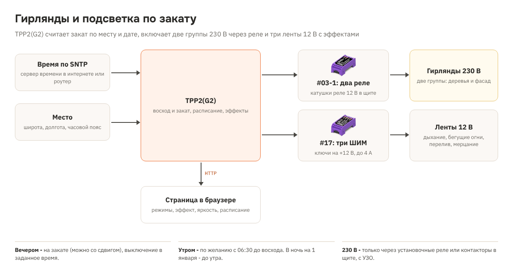
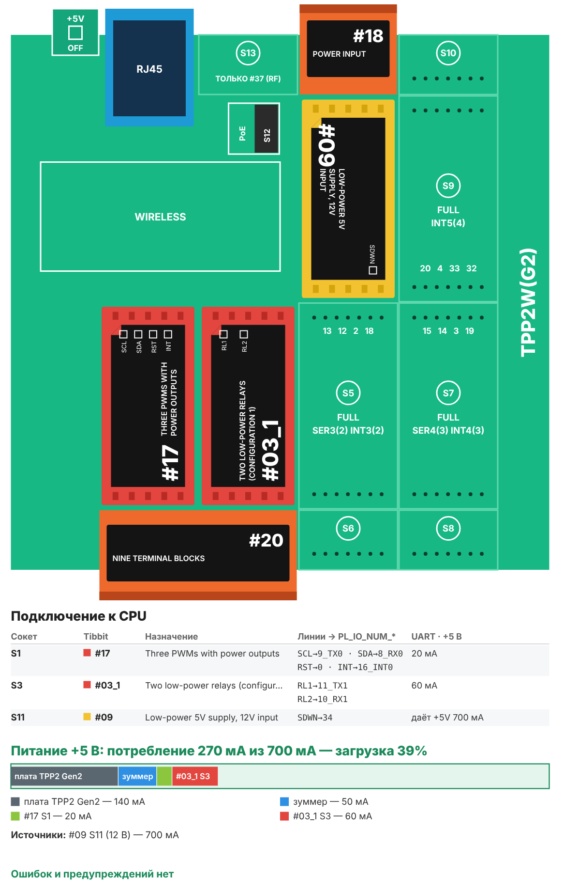

# Рецепт 22. Гирлянды и подсветка по закату: расписание и световые эффекты

Новогодний рецепт, который полезен круглый год. Контроллер сам считает время заката для вашего города и включает подсветку фасада, витрины или гирлянды на деревьях. Ночью выключает в заданное время, утром при желании включает снова - до восхода. В ночь на 1 января горит до утра.

Кроме реле на 230 В, у контроллера три канала на 12 В для светодиодных лент и гирлянд с эффектами: дыхание, бегущие огни, перелив, мерцание. Всё настраивается на веб-странице контроллера с телефона.

| | |
|---|---|
| Плата | Tibbo [TPP2(G2)](https://tibbo.ru/products/tpp2-gen2) в корпусе TPB2 |
| Выходы 230 В | 2 реле ([Tibbit #03-1](https://tibbo.ru/products/tibbit-03-1-m1s)) включают катушки установочных реле или контакторов 12 В в щите |
| Выходы 12 В | 3 канала ШИМ 2 кГц ([Tibbit #17](https://tibbo.ru/products/tibbit-17-m1s)), ключ на +12 В, до 2 А на канал по этому рецепту |
| Время | SNTP; восход и закат считаются по широте, долготе и дате |
| Управление | веб-страница: «По закату», «Включить», «Выключить» для каждой группы, эффект, яркость, скорость, расписание, место |
| Питание | 12 В DC ([Tibbit #09](https://tibbo.ru/products/tibbit-09-m1s)), от того же блока - ленты и катушки реле |
| Прошивка | Tibbo BASIC, TIDE, библиотеки 2_01_05 |
| Проверка | Собирается компилятором Tibbo без ошибок. Предупреждения - только в файлах Tibbo для работы с #17 (переопределение `SSI_MAX_SIGNATURE_LEN`). Расчёт заката сверен на модели с астрономической библиотекой. На плате, с лентами и реле не проверялось |
| Лицензия | MIT (кроме файлов Tibbo, см. ниже) |

## Что в архиве

| Файл | Что это |
|---|---|
| `tide/` | Проект TIDE. Настройки по умолчанию - в `config.tbh` |
| `tide/PIC_HAL.*`, `tide/pic_gra.*`, `tide/super_i2c.*` | Файлы Tibbo для работы с Tibbit #17 из примера [CA-Test-Tibbits-16-17-31](https://github.com/tibbotech/CA-Test-Tibbits-16-17-31), без изменений. Права на них - у Tibbo Technology, лицензия рецепта на них не распространяется |
| `bom.csv` | Спецификация |
| `board.svg`, `board.png` | Раскладка Tibbit по сокетам и бюджет питания |
| `scheme.png` | Схема решения |

## Комплект

| Кол-во | Позиция | Сокет |
|---|---|---|
| 1 | Плата TPP2(G2) | - |
| 1 | Корпус TPB2 | - |
| 1 | Tibbit #17 - три канала ШИМ с силовыми выходами | S1 |
| 1 | Tibbit #03-1 - два маломощных реле | S3 |
| 1 | Tibbit #20 - 9 клемм | S2+S4 (выходы #17 и контакты реле) |
| 1 | Tibbit #09 - источник питания 5 В от 9-18 В | S11 |
| 1 | Tibbit #18 - разъём питания и 2 клеммы | S12 (вход 12 В) |
| 1 | Блок питания 12 В DC на DIN-рейку, 100-150 Вт | не входит в каталог Tibbo |
| 2 | Установочное реле или модульный контактор с катушкой 12 В DC, контакты под нагрузку 230 В | не входит в каталог Tibbo |
| 3 | Светодиодная лента или гирлянда 12 В, одноцветная, до 2 А | не входит в каталог Tibbo |
| 3 | Предохранитель 2,5 А с держателем | не входит в каталог Tibbo |

Потребление по линии +5 В - около 270 мА при запасе источника #09 700 мА (загрузка 39 %).

**Почему такой блок питания.** Три ленты по 2 А - 6 А, контроллер и катушки реле - ещё около 0,5 А. Блок на 100 Вт (8,3 А) загружен на 78 %, на 150 Вт - на 52 %. Брать впритык не стоит: блок будет греться, а зимой на улице ему и так тяжело.

**Почему до 2 А на канал.** Ключи #17 по документации Tibbo держат 4 А при комнатной температуре. В закрытом щите теплее, поэтому в рецепте - половина: около 24 Вт на канал, например 2,5 м ленты на 9,6 Вт/м.

**Почему одноцветные ленты.** Ключи #17 стоят в плюсовом проводе: выход даёт +12 В, минус ленты идёт на общий минус. Одноцветная лента или гирлянда на 12 В с двумя проводами подключается напрямую. RGB-лента с общим плюсом так не подключится - для неё нужны ключи в минусовом проводе.

## Важно про 230 В

Реле #03-1 рассчитаны на 1 А при 30 В. **Не подключайте к ним 230 В и гирлянды напрямую.** Реле включают катушки установочных реле или модульных контакторов 12 В в щите, а уже их контакты коммутируют 230 В.

Силовую часть собирает электрик:

- уличные гирлянды - через УЗО;
- автоматический выключатель на каждую группу;
- контакты установочного реле - с запасом по току. У светодиодных гирлянд с блоками питания большой пусковой ток, на 1 кВт лучше брать контактор.

## Сборка

1. Вставьте Tibbit в сокеты по таблице. Ключ на корпусе Tibbit совпадает с ключом сокета.
2. Питание: +12 В блока - на клемму 1 #18 в S12, 0 В - на клемму 2. Это вход #09.
3. Клеммы #20 в S2+S4. В виде Wiring редактора AppBlocks у #20 на TPP2(G2) клеммы 1-4 идут на первый из двух M-модулей, клемма 5 - земля, клеммы 6-9 - на второй (так проверено для #20 в S10+S12). Здесь первый модуль - #17 в S1, второй - #03-1 в S3:

   | Клемма #20 | Линия | Что подключить |
   |---|---|---|
   | 1, 2, 3 | #17: IO1, IO2, IO3 | плюсы трёх лент, каждая через свой предохранитель 2,5 А |
   | 4 | #17: IO4 | +12 В блока питания через предохранитель - питание ключей |
   | 5 | земля | минус блока питания |
   | 6-7 | #03-1: реле 1 | в разрыв цепи катушки установочного реле группы 1 |
   | 8-9 | #03-1: реле 2 | в разрыв цепи катушки установочного реле группы 2 |

   Минусы лент ведите прямо на минус блока питания, не через клемму 5: ток лент не должен идти через плату. **До подачи 12 В проверьте назначение клемм в виде Wiring редактора AppBlocks (плата TPP2(G2), #17 в S1, #03-1 в S3, #20 в S2) и тестером: на железе это не проверялось.**
4. Цепь катушки: +12 В блока → контакты реле на #20 → катушка установочного реле → 0 В.
5. Если у катушки установочного реле нет встроенного диода, поставьте диод параллельно катушке (катодом к +12 В): иначе контакты #03-1 будут обгорать.
6. Подключите Ethernet.

## Как это работает

| Что | Как |
|---|---|
| Закат и восход | Раз в сутки по широте, долготе, часовому поясу и дате (формулы NOAA). В TiOS нет синуса и косинуса - они посчитаны в `sun.tbs`. Сверено с библиотекой astral на 2026-2027 годы: для Москвы, Петербурга, Новосибирска, Сочи, Алматы и Минска расхождение не больше 5 минут, в среднем 1-2 минуты |
| Вечер | Включение на закате со сдвигом (например, «закат - 15 минут»), выключение в заданное время, можно после полуночи |
| Белые ночи | Если выключение назначено на вечер раньше заката, вечером подсветка не включается |
| Утро | По желанию: с заданного времени до восхода, если к этому времени ещё темно |
| Новогодняя ночь | 31 декабря - с вечернего включения до восхода 1 января |
| Полярная ночь и день | Солнце не встаёт - подсветка горит с полудня, кроме ночного перерыва. Не заходит - вечером не включается |
| Ручной режим | «Включить» и «Выключить» действуют, пока не нажата «По закату» |
| Ленты | Плавное включение и выключение около 2,5 с, яркость с гамма-поправкой, эффекты обновляются каждые 50 мс |
| После пропадания питания | Реле выключены, ленты погашены. Режимы и настройки - из EEPROM; как только придёт время по SNTP, подсветка встанет в нужное состояние |
| Нет времени | В режиме «По закату» подсветка выключена, на странице - предупреждение. Часы можно поставить вручную |

**Эффекты.** Каналы IO1-IO3 работают как три гирлянды:

- **Ровный свет** - все три горят.
- **Дыхание** - плавно разгораются и гаснут вместе.
- **Бегущие огни** - по очереди, как в классической гирлянде.
- **Перелив** - плавно сменяют друг друга.
- **Мерцание** - каждая медленно меняет яркость, как свечи.

## Как пользоваться

| Что | Где |
|---|---|
| Управление | `http://<IP>/`: восход и закат на сегодня, время включения и выключения, кнопки групп, эффект, расписание, место |
| Мониторинг | `http://<IP>/state.txt` - строки `ключ=значение`: время, закат, состояние выходов, режимы, эффект, `pwm_ok` |

Место задаётся в десятичных градусах: Москва - 55.7558 и 37.6173, часовой пояс - минуты от UTC (180). Южная широта и западная долгота - со знаком минус.

## Безопасность

Страница открывается без пароля. Ставьте контроллер в сеть, куда нет доступа из интернета, или закройте доступ к нему на роутере.

## Загрузка прошивки

1. Установите [TIDE](https://tibbo.ru/downloads) и откройте `tide/festive_lighting.tpr`.
2. Поправьте `config.tbh`: сеть, сервер времени, место по умолчанию. Нажмите F7 (сборка).
3. Выберите контроллер в Device Explorer и нажмите F5. Для работы на объекте переключите сборку в Release и загрузите ещё раз.
4. В отладочном окне TIDE после включения должно появиться `Tibbit #17 ready`, а после получения времени - восход и закат на сегодня.

## Что проверить на стенде

- что #17 отвечает: на странице нет предупреждения, в отладке - `Tibbit #17 ready`;
- что ленты не мерцают заметно на глаз и камерой телефона: ШИМ 2 кГц;
- нагрев #17 при полной яркости и вашем токе в закрытом корпусе;
- время заката на странице против таблицы для вашего города;
- что катушки установочных реле срабатывают от 12 В.

## Частые проблемы

| Симптом | Что проверить |
|---|---|
| «Tibbit #17 не ответил» | #17 стоит в S1; на нём прошивка GRA (с ней Tibbit поставляется) |
| Ленты не светятся, #17 ответил | +12 В на IO4; минус ленты - на минус блока питания; предохранители |
| Подсветка не включилась вечером | Режим «По закату», часы установлены, время выключения не раньше заката |
| Закат на странице не совпадает с городом | Широта, долгота и часовой пояс на странице «Место» |
| Реле щёлкает, свет не включается | Цепь катушки установочного реле, его автомат и контакты |

## Доработка с Claude

Со [скиллами Tibbo для Claude](https://tibbo.ru/skills.html) проект можно менять словами:

- «Добавь в рецепт 22 датчик освещённости и включай подсветку, когда темнеет, а не по расписанию»
- «Сделай на ленте эффект "снегопад" и включай его только по выходным»
- «Отправляй состояние подсветки в MQTT»

## История версий

| Версия | Что изменилось |
|---|---|
| 1.0.0 | Первая версия |
